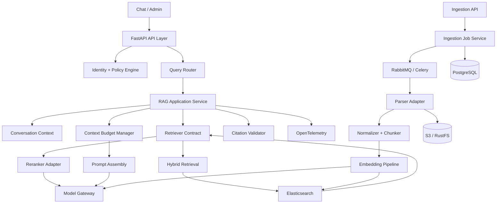
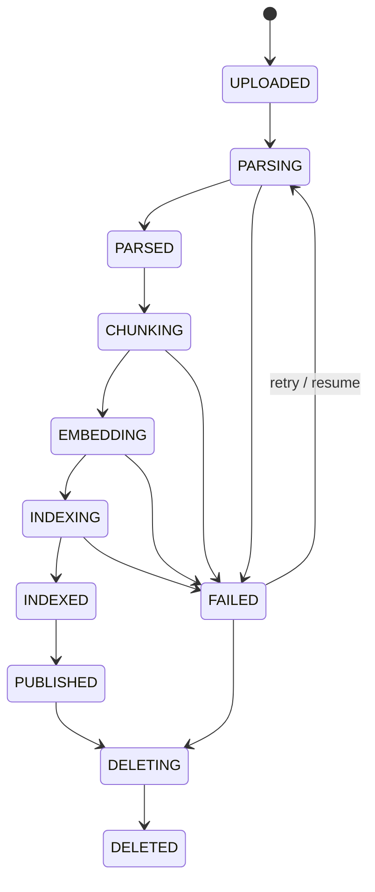
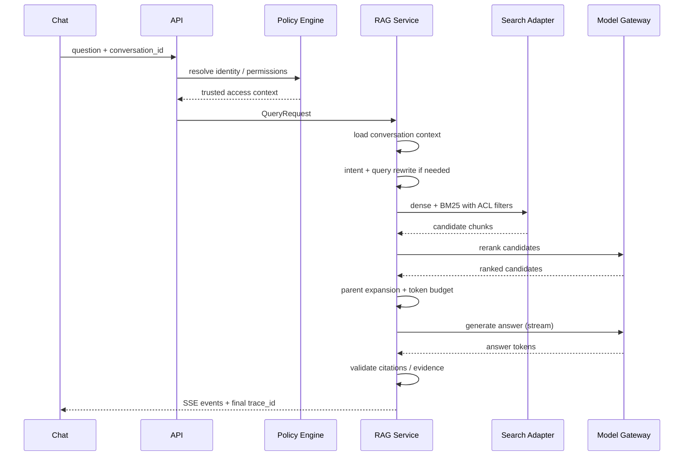

# Enterprise Agentic AI Platform

> 公共字段、状态、事件、权限与迁移映射见 [统一契约与跨版本演进规则](../../architecture/统一契约与跨版本演进规则.md)；本文件描述本版能力及增量，具体实现须通过契约与升级验收。
# RAG Engine 详细技术设计

- 文档版本：V1.0
- 日期：2026-11-23
- 状态：研发基线（待 POC 验收后冻结实现参数）
- 适用范围：第一期 MVP Standard RAG；为 V1.1 Retriever Tool 与 V1.3 Agentic RAG 保留稳定接口

## 1. 设计目标与边界

### 1.1 目标

交付可用于企业内部知识问答的 Standard RAG Engine，具备：

1. 文档从上传、解析、切片、向量化、索引到发布的可追踪入库闭环。
2. Hybrid Retrieval：Dense + BM25 + RRF + Reranker，并支持 Metadata / ACL Filter。
3. 多轮对话中的指代解析与 Query Rewrite。
4. Token Budget 管理、上下文组装、可验证引用、无证据拒答。
5. 全链路 Trace、检索诊断、Golden Dataset 评测和配置版本管理。
6. 通过 Retriever Contract 与 Agent Runtime 解耦，避免 Agent 直接访问搜索基础设施。

### 1.2 非目标（MVP 不实现）

- 复杂 Agent Planner、多 Agent 协作和自主多步任务。
- GraphRAG、知识图谱推理、多模态向量检索。
- 自研向量数据库或搜索引擎。
- 完整的长期用户记忆系统；MVP 只实现会话上下文。
- 任意外部系统直连 RAG Engine；业务数据查询统一走 Tool Gateway。

### 1.3 已确认技术基线

| 能力 | 基线 | 设计约束 |
|---|---|---|
| API | FastAPI | 平台 API Contract 自主维护 |
| RAG 编排 | LlamaIndex | 作为组件框架，不承载平台核心业务模型 |
| Parser | Docling 默认，MinerU 复杂 PDF 备选 | Parser Adapter 统一输出 |
| Search | Elasticsearch | Dense、BM25、Hybrid、Filter；Search Adapter 隔离 |
| Embedding / Chat / Reranker | Model Gateway Facade + LiteLLM | 所有模型调用经过统一网关 |
| 异步任务 | RabbitMQ + Celery | 幂等、重试、断点恢复 |
| DB | PostgreSQL | 业务元数据与状态事实源 |
| Cache | Redis | 短期缓存、限流辅助、任务协调 |
| Object Storage | S3 compatible / RustFS | 原件及解析产物 |
| Observability | OpenTelemetry + Phoenix | 平台自有 Trace 元数据 |
| Evaluation | RAGAS + Golden Dataset | 离线回归与版本对比 |

## 2. 总体架构



### 2.1 分层职责

- **API Layer**：鉴权、参数校验、SSE、错误映射、请求关联 ID。
- **RAG Application Service**：编排一次问答生命周期，不耦合 ES 查询 DSL。
- **Query Router**：判定普通知识问答、复杂问题或实时业务查询。MVP 默认路由 Standard RAG；复杂 Agent 路由仅预留。
- **Retriever Contract**：统一检索接口；Agent Runtime 未来也只能通过此接口访问知识。
- **Search Adapter**：把平台查询模型转换为 Elasticsearch DSL。
- **Model Gateway**：统一 Chat、Streaming、Embedding、Reranker 调用。
- **Policy Engine**：生成可信的用户、角色、KB、文档 ACL 上下文；检索前强制过滤。
- **Ingestion Pipeline**：异步处理文档，状态事实以 PostgreSQL 为准。
- **Evaluation / Diagnostics**：对检索和生成进行可重复验证。

## 3. 核心领域模型

### 3.1 Document 与 Chunk

Document 表示知识库中的一个逻辑文档及其版本；Chunk 表示可检索片段。建议字段：

- Document：`id, kb_id, title, source_type, source_uri, object_key, mime_type, file_hash, version, status, parser_name, parser_version, metadata_json, acl_policy_id, created_by, created_at, updated_at, deleted_at`
- Chunk：`id, document_id, document_version, kb_id, chunk_index, parent_chunk_id, content, token_count, page_no, heading_path, char_start, char_end, metadata_json, acl_snapshot, embedding_model, content_hash, created_at`
- IndexVersion：`id, kb_id, version, physical_index_name, embedding_model, chunking_config_version, status, validation_report, created_at, published_at`
- IngestionJob：`id, document_id, document_version, job_type, status, stage, retry_count, idempotency_key, progress_json, error_code, error_message, started_at, finished_at`

`acl_snapshot` 仅作为索引过滤所需的权限标签快照，权威权限仍以 Policy Engine / PostgreSQL 为准；权限变更必须触发索引 ACL 更新或重建，并在查询时采用可信的当前权限约束。

### 3.2 文档状态机



- `UPLOADED` 不代表可检索。
- 只有发布到当前活动 IndexVersion 的文档才可被在线检索。
- 失败任务记录失败阶段和可重试错误；不可重试错误需人工修复输入或配置。
- 删除是异步幂等流程，成功后文档状态为 `DELETED`。

## 4. 离线 Ingestion 设计

### 4.1 流程

1. 接收上传：校验 MIME、扩展名、文件大小、恶意文件扫描结果。
2. 计算 SHA-256，按 KB + 文件 Hash 做重复检测；是否允许同内容多版本由 KB 配置决定。
3. 原件写入对象存储，PostgreSQL 写入 Document、DocumentVersion、IngestionJob。
4. 投递 Celery 任务；API 返回 `document_id`、`job_id` 和初始状态。
5. Parser Adapter 默认调用 Docling；先完成首期基础解析，实际样本证明 Docling 有明确缺口后，再验证并按已确认策略接入 MinerU。
6. 统一输出 `ParsedDocument`：页面、段落、表格、标题层级、来源位置、解析告警。
7. Normalizer 统一空白、编码、页码、标题路径和结构元数据。
8. Structure-aware Chunker 按标题、段落、表格边界切片；支持 Parent-Child。
9. Metadata / ACL 注入：继承 KB ACL，并叠加文档级策略。
10. 通过 Model Gateway 批量生成 Embedding。
11. 写入 Elasticsearch 新索引版本；写入前后校验维度、字段和文档数。
12. 执行索引验证与抽样检索；验证通过后原子切换 alias。
13. 发布 Document 与 IndexVersion 状态，记录版本及任务结果。

### 4.2 ParsedDocument 契约

```python
class ParsedDocument:
    document_id: str
    version: int
    parser: str
    parser_version: str
    pages: list["ParsedPage"]
    metadata: dict
    warnings: list[str]

class ParsedPage:
    page_no: int
    blocks: list["ParsedBlock"]

class ParsedBlock:
    block_id: str
    block_type: str  # heading, paragraph, table, list, caption
    text: str
    heading_path: list[str]
    bbox: dict | None
    source_location: dict
    metadata: dict
```

Parser 只负责内容解析，不直接写 ES、不决定 ACL、不负责平台 Document 状态。

当前优先完成 Docling 的 Markdown、DOCX、PDF 基础解析；MinerU 保留为 PDF 备选，不作为当前集成依赖。先收集 Docling 在实际样本上的内容、表格、阅读顺序、引用定位及耗时证据；缺口经配置/OCR/Adapter 排查仍存在时，再按 [POC-02](04-poc-acceptance-and-adr.md) 使用同一批失败样本验证 MinerU，并保持 ParsedDocument 输出契约。

### 4.3 Chunking 策略

- 默认使用结构感知切片，不简单按固定字符数截断。
- 优先保留标题、段落、列表和表格完整性。
- Parent Chunk 保存较完整的章节上下文；Child Chunk 用于精确召回。
- 每个 Chunk 保留 `document_id/version, kb_id, page_no, heading_path, source_location, acl tags`。
- `chunk_size`、`chunk_overlap`、表格处理策略均版本化，不能在重建索引时静默改变。
- 初始参数仅作为实验起点，最终由 Golden Dataset 评测决定。

### 4.4 幂等、重试与恢复

- `idempotency_key = hash(document_id + version + pipeline_version + stage)`。
- 每个 stage 写入开始、成功、失败记录；重复消息不得产生重复 Chunk 或重复索引文档。
- Celery retry 仅用于可恢复错误；指数退避并设置最大重试次数。
- 解析产物、Chunk 结果和 Embedding 批次可持久化，支持从失败阶段恢复。
- Worker 至少实现任务超时、租约/锁过期恢复、死信或失败任务可观测。
- 任务状态更新使用条件更新或版本号，避免并发 Worker 覆盖状态。

### 4.5 索引版本与发布

- 采用 `kb_{id}_v{n}` 物理索引与稳定 alias。
- 新版本完整构建，不在活动索引上原地大规模改写。
- 验收：字段映射、向量维度、文档/Chunk 数、ACL 字段、抽样查询、质量阈值。
- 通过后 alias 原子切换；失败保留旧版本继续服务。
- 回滚只切换 alias，不重新生成旧版本。
- 保留策略由容量和合规要求确定；清理旧索引前检查仍被 Trace / 评测任务引用的依赖。

### 4.6 删除与数据生命周期

删除必须覆盖：原件、解析产物、Chunk、索引文档、缓存、关联元数据和任务产物。执行过程可重试，记录删除清单与结果。对离职用户的会话数据生命周期另由 Data Lifecycle Service 负责，不与知识文档删除混为一谈。

## 5. 在线 Standard RAG 设计

### 5.1 请求链路



### 5.2 Query Router 与 Query Rewrite

MVP 支持：
- 普通知识问答：直接检索。
- 多轮指代问题：结合最近 N 轮上下文进行独立 Query Rewrite。
- 明确实时业务查询：返回“当前 MVP 未接入该业务数据源”或转入已配置 Tool Gateway；不得把实时数据问题伪装成知识库事实。
- 复杂跨文档问题：MVP 仍由 Standard RAG 尝试回答，并标记复杂度；Agentic RAG 在后续阶段启用。

Rewrite 结果必须保留原始 Query，Trace 中记录原始问题、改写问题、触发原因和模型版本。不能把对话历史无限拼接进 Prompt。

### 5.3 Hybrid Retrieval

默认执行：
1. 生成 Query Embedding，加载可信当前 ACL、KB/文档发布状态和允许的 Metadata 筛选。
2. Dense 检索 Top-K，在召回前强制应用上述过滤。
3. BM25 检索 Top-K，在召回前应用相同过滤。
4. 统一候选 ID，由 Search Adapter 执行 RRF 融合（Basic 许可下不依赖 ES 原生 RRF，见 [ADR-0016](../../adr/0016-client-side-rrf-under-basic-license.md)）。
5. 返回候选再次核对当前授权和状态；索引快照不能替代可信当前 Policy。
6. 去重、必要时 Parent Context Expansion。
7. Reranker 重排。
8. 选择满足上下文预算的证据片段。

建议初始实验参数（非生产承诺，必须由 POC/Golden Dataset 调整）：

| 参数 | 初始值 |
|---|---:|
| Dense Top K | 40 |
| BM25 Top K | 40 |
| RRF rank constant | 60 |
| Reranker 输入 | 20 |
| 最终上下文 Chunk | 5–10 |

ES Query 由 Search Adapter 生成。RAG Service 不暴露 ES DSL 给上层。

### 5.4 ACL 安全检索

- API 层认证后，Policy Engine 根据可信身份计算可访问 KB、Document 标签和角色。
- 检索请求必须包含服务端生成的 ACL Filter；客户端不得传入或覆盖可信 ACL。
- ES 过滤作为第一道边界；返回后再次按可信 ACL 做结果校验。
- 缺少 ACL 上下文时 fail closed，不允许退化为全库检索。
- KB / Document 权限变更需同步索引标签；同步窗口期间采取更严格策略（例如先拒绝、后开放），避免权限撤销后仍可读。
- 评测、调试台和后台预览也必须执行权限边界；超级管理员调试能力应显式审计。

### 5.5 Context Assembly 与 Token Budget

Context Budget Manager 输入：
- 模型上下文窗口及输出预留。
- System / Developer Prompt 固定 Token。
- 对话历史预算。
- 当前问题与 Rewrite。
- 检索证据预算。
- 工具/结构化元数据预算（未来）。

规则：
- 预留最大输出 Token 和安全余量。
- 历史优先保留最近相关轮次；必要时生成受控摘要，但 MVP 可先做滑动窗口。
- 证据按 rerank 分数、来源多样性和覆盖度排序。
- 超预算时先移除低分证据，再压缩历史；不截断引用 ID 与来源元数据。
- 在 Trace 中记录预算、实际 Token、被裁剪内容数量及原因。
- 模型窗口未知或 Token 估算失败时采用保守预算。

### 5.6 Prompt 与生成

- Prompt 模板版本化，包含 system policy、回答规范、证据格式、拒答规则。
- 明确要求模型仅基于提供证据回答；证据不足时说明不足。
- 文档内容视为不可信输入，防止 Prompt Injection；不得执行文档中要求泄露系统提示或调用工具的指令。
- 敏感信息按策略脱敏；模型输出需做基础安全校验。
- Streaming 期间可发送 `answer_delta`；引用和最终可信状态在结束阶段校验后发送。
- 生成异常、超时、限流和供应商错误必须映射为稳定错误码。

### 5.7 Citation 生成与验证

每条引用至少包含：
`citation_id, document_id, document_version, chunk_id, title, page_no, heading_path, excerpt, score, source_uri`。

验证要求：
- 引用必须来自本次检索且通过 ACL 的 Chunk。
- 不接受模型自由编造 document_id / page_no。
- 输出中的 citation marker 必须映射到服务端候选引用集合。
- 被引用文档必须处于允许访问的发布版本。
- 无证据或验证失败时降级为拒答/谨慎回答，并记录 `citation_validation_failed`。
- UI 展示的页码、标题、摘录来自平台元数据，不信任模型生成字段。

### 5.8 SSE 事件协议

建议事件：
- `message_start`: `message_id, trace_id`
- `retrieval_status`: `stage`
- `answer_delta`: `delta`
- `citation`: `citation`
- `message_complete`: `message_id, trace_id, usage, finish_reason`
- `error`: `code, message, retryable`

事件顺序和字段形成 API 契约；断线恢复策略由客户端携带 message / cursor 信息实现，第一期可先支持重新发起，不承诺无损续传。

## 6. Retriever Contract

```python
class RetrievalRequest:
    query: str
    kb_ids: list[str]
    filters: dict
    access_context: AccessContext  # server generated
    top_k: int
    config_version: str | None
    trace_id: str

class RetrievalResult:
    chunks: list[RetrievedChunk]
    diagnostics: RetrievalDiagnostics

class RetrievedChunk:
    chunk_id: str
    document_id: str
    document_version: int
    kb_id: str
    content: str
    score: float
    score_components: dict
    source: dict
    metadata: dict

class Retriever(Protocol):
    async def retrieve(self, request: RetrievalRequest) -> RetrievalResult: ...
```

Contract 不包含 Elasticsearch 专有字段。未来可替换搜索引擎，也可供 LangGraph Retriever Tool 调用。

## 7. 配置、版本与实验

配置版本至少包含：
- Query Rewrite 开关与模型。
- Dense / BM25 Top-K、RRF 参数。
- Reranker 模型与 Top-K。
- Chunking 配置版本。
- Context Token Budget。
- Prompt Template 版本。
- Citation / Refusal 策略。
- Embedding 模型和向量维度。

配置发布流程：草稿 → Golden Dataset 评测 → 对比当前生产版本 → 审批/发布 → 观察 → 回滚。配置与索引版本需记录兼容关系，禁止在不兼容 Embedding 维度下切换。

## 8. Trace 与诊断

每次问答一个 Trace；一个 Conversation 可包含多个 Trace。建议 Span：
- `auth.policy`
- `query.route`
- `conversation.load`
- `query.rewrite`
- `embedding.query`
- `retrieval.dense`
- `retrieval.bm25`
- `retrieval.fusion`
- `retrieval.rerank`
- `context.assemble`
- `llm.generate`
- `citation.validate`
- `response.stream`

记录：耗时、Token、模型/配置版本、Top-K、过滤数量、召回文档 ID、分数、错误码。默认匿名，不在普通 Trace UI 暴露姓名、部门或 sourceId；高危溯源由超级管理员授权、填写理由、二次确认并审计。

## 9. 性能、可靠性与安全

- 外部模型调用设置连接/读取超时、并发限制、RPM/TPM 限流和重试预算。
- 只对幂等请求安全重试；流式生成中途失败不应无条件重复生成并重复计费。
- ES 查询设置 timeout、最大候选数和请求体限制。
- Embedding 批量化，按模型能力与 Token 限制分批。
- Celery Worker 与 API 独立扩缩容；队列积压、任务时长和失败率可观测。
- Redis 只缓存可安全复用的短期数据；缓存 Key 必须包含有效用户/资源授权上下文或使用严格隔离，权限变化时失效。
- Prompt Injection、恶意文件、超大文件、敏感信息、越权检索、删除残留均纳入测试。
- 具体 P95、并发数、吞吐量阈值由目标环境 POC 定标，不在未测量前承诺。

## 10. MVP 验收标准

1. 支持至少一种常用文档格式端到端入库，状态可观察。
2. 失败任务可重试，重复任务不产生重复 Chunk / 索引数据。
3. 新索引验证通过后发布，失败可回滚。
4. Dense + BM25 + RRF + Reranker 可运行，支持 Metadata / ACL Filter。
5. 普通问答和多轮指代问答可用。
6. 引用可追溯到真实 Document / Chunk / Page，无法验证时拒答或降级。
7. 无证据问题不会编造知识库事实。
8. 用户无法通过 API、检索、调试台越权访问文档。
9. Token Budget 防止上下文窗口超限。
10. 每次问答有 Trace，可诊断召回、重排、Prompt、Token、耗时和错误。
11. Golden Dataset 可执行，能对比检索参数和 Prompt 版本。
12. 删除链路覆盖对象存储、解析产物、Chunk、索引和缓存。

## 11. 待 POC 决策项

- Elasticsearch 版本、Dense 向量字段类型、Hybrid Query 方式和 ACL Filter 性能。
- 先验证 Docling 对目标 Markdown、DOCX、PDF 样本的解析质量、表格保真度与耗时；实际缺口触发时再验证 MinerU，不提前要求双 Parser 对比。
- LlamaIndex 组件使用边界与升级兼容性。
- Embedding / Reranker 模型选择、维度、批大小、成本和限流。
- Chunking 参数与 Parent-Child 召回收益。
- 质量指标门槛与性能 SLO。
