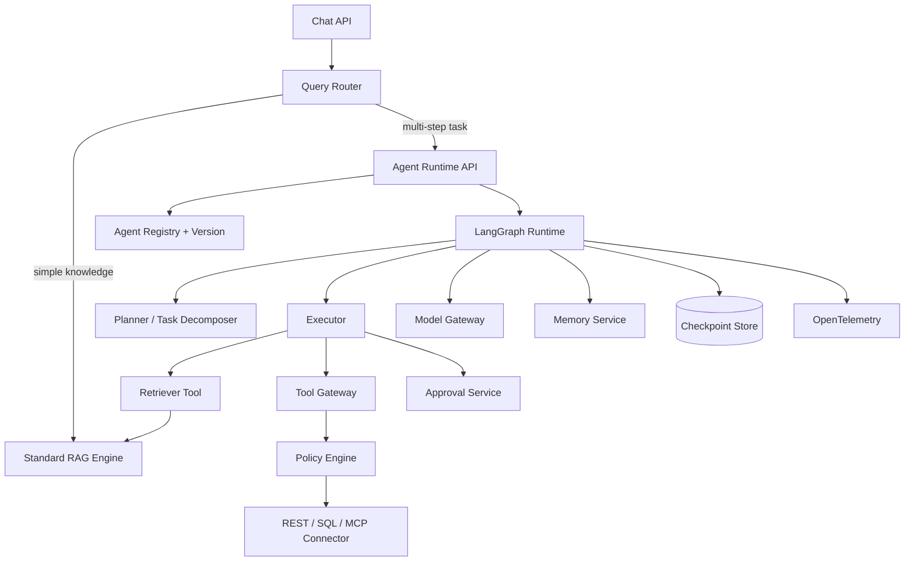
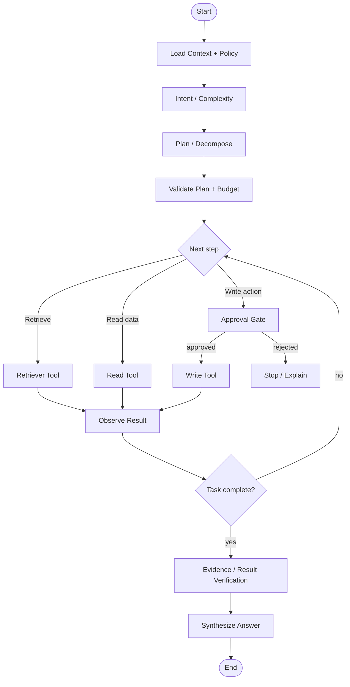

# Enterprise Agentic AI Platform

> 公共字段、状态、事件、权限与迁移映射见 [统一契约与跨版本演进规则](../../architecture/统一契约与跨版本演进规则.md)；本文件描述本版能力及增量，具体实现须通过契约与升级验收。
# Agent Runtime 详细技术设计

- 文档版本：V1.0
- 日期：2026-11-23
- 状态：目标架构设计；V1.0 仅实现边界与基础契约；单 Agent 底座 V1.1、管理平台 V1.2、高级执行 V1.3、企业流程 V1.4

## 1. 设计目标与范围

Agent Runtime 负责管理 Agent 的执行生命周期、状态、规划、工具调用、审批、重试和可观测性。它不负责直接实现 RAG 检索，也不直接访问 Elasticsearch、PostgreSQL 业务表或企业系统。

技术基线：**LangGraph** 作为 Agent Runtime；RAG Engine、Model Gateway、Tool Gateway、Policy Engine 均为独立平台服务/模块，通过稳定 Contract 调用。

### 1.1 MVP 与后续版本边界

下表“第二阶段”是后续能力集合的旧称，不是单一产品版本。能力映射：Runtime/只读 Tool/Checkpoint→V1.1；Registry/版本发布→V1.2；Planner/Multi-Agent/HITL→V1.3；生产业务写操作与企业审批流程→V1.4。具体字段及状态采用统一契约规则，不以本文目标态示例覆盖版本增量。

| 能力 | MVP | 后续版本（按上述映射） |
|---|---|---|
| Runtime 模块边界、接口和 Trace 规范 | 实现 | 扩展 |
| 普通知识问答 | Standard RAG，不走 Agent | 保持 |
| Agent Registry / 基础配置模型 | 可预留表/API | 完整管理 |
| LangGraph 执行图 | 不开放复杂 Planner | 启用 |
| Tool Gateway Contract | Mock Connector / 基础框架 | 生产 Connector、MCP |
| Human-in-the-loop | 可预留审批接口 | 完整审批流 |
| Checkpoint / Resume | 基础技术验证 | 生产化 |
| Multi-Agent | 不做 | 视场景评估 |
| 长期 Memory | 不做 | 独立 Memory Service |

第一期不应为了“架构完整”而把所有聊天请求都送入 Agent。标准知识问答继续由 Standard RAG 处理，控制延迟、成本和故障面。

## 2. 目标架构



## 3. 核心设计原则

1. **Runtime 与能力服务分离**：LangGraph 编排，RAG / Tool / Model / Memory 是受控能力。
2. **工具最小权限**：每次 Tool Call 都由 Tool Gateway + Policy Engine 授权，不信任 Agent 自行声明的权限。
3. **执行有界**：限制最大步骤、最大工具调用数、最大执行时长、Token、成本和递归深度。
4. **状态可恢复**：Checkpoint 记录执行状态；恢复前重新校验用户状态、权限、工具版本和审批有效期。
5. **高风险操作必须审批**：写入、删除、付款、发送外部消息等动作按策略触发 Human-in-the-loop。
6. **所有动作可审计**：输入、计划摘要、工具参数摘要、结果摘要、审批人、执行结果和 Trace 关联。
7. **不绕过平台治理**：Agent 不得持有企业系统长期凭证，不得直连业务数据库或搜索集群。
8. **框架可替换**：平台自有 Agent / Run / Step / Tool / Checkpoint 业务模型，不把 LangGraph State 当成唯一事实源。

## 4. Agent 生命周期与领域模型

### 4.1 核心对象

- `AgentDefinition`：Agent 名称、说明、所属团队、状态、默认模型、系统 Prompt、允许工具、策略、版本。
- `AgentVersion`：不可变发布版本，包含 Prompt、Graph Definition、模型引用、Tool Allowlist、预算、评测结果。
- `AgentRun`：一次用户发起的执行，记录用户、Agent 版本、状态、TraceId、开始/结束时间、成本。
- `AgentStep`：计划节点、模型推理节点、Tool Call、检索调用、审批等待等步骤。
- `ToolDefinition`：工具 Contract、输入/输出 Schema、风险等级、权限策略、超时和重试策略。
- `ToolExecution`：单次工具调用记录，包含脱敏参数、调用方身份、授权结果、执行结果。
- `ApprovalRequest`：审批对象、风险说明、请求参数摘要、状态、审批人、到期时间。
- `Checkpoint`：可恢复状态的引用和版本；敏感数据按最小化原则存储。
- `MemoryItem`：未来 Memory Service 的独立数据模型，具有用户/Agent/会话范围、TTL、来源与删除策略。

### 4.2 状态机

AgentRun：
`QUEUED → ACCEPTED → RUNNING → WAITING_APPROVAL / WAITING_INPUT → RUNNING → SUCCEEDED | FAILED | CANCELLED | TIMED_OUT`

- 进入 `WAITING_APPROVAL` 后不占用长时间 Worker；通过事件/轮询恢复。
- 用户取消、超时、离职禁用、Agent 版本撤销都可终止执行。
- 重试创建新的 Step Attempt，保留原失败记录；不得覆盖历史动作。
- 已执行的外部副作用必须通过幂等键或补偿机制处理。

## 5. LangGraph 执行图设计

### 5.1 推荐图结构



### 5.2 State Schema

State 仅包含完成执行所需的数据引用和结构化状态，避免无边界复制对话全文或敏感数据。

```python
class AgentState(TypedDict):
    run_id: str
    trace_id: str
    agent_id: str
    agent_version: str
    user_context_ref: str
    conversation_id: str
    user_request: str
    plan: list[dict]
    current_step: int
    evidence_refs: list[dict]
    tool_results: list[dict]
    pending_approval_id: str | None
    budget: dict
    status: str
    final_answer: str | None
    error: dict | None
```

`user_context_ref` 指向服务端可信上下文，不允许模型自行生成身份或权限字段。Checkpoint 不应保存明文 API Key、OAuth Token 或不必要的个人信息。

### 5.3 Planner 与 Executor

Planner 输出结构化计划，不直接执行工具。计划经过 Schema Validation、Policy Pre-check 和 Budget Validation 后交由 Executor。

Plan Step 至少包括：
`step_id, objective, capability_type, tool_id, input_schema_ref, depends_on, expected_output, risk_level, timeout_seconds`。

Planner 约束：
- 只能从 Agent Version 的 Tool Allowlist 选择工具。
- 不得修改身份、ACL、策略和审批要求。
- 计划步数、循环次数、模型 Token 和预计成本必须有上限。
- 无法制定安全计划时停止并向用户说明。
- Planner 的自然语言理由不是授权依据。

Executor：
- 负责按依赖关系执行步骤。
- 对每次调用生成唯一 `tool_execution_id` 和幂等键。
- 对只读调用按策略重试；写操作需幂等保证或审批。
- 将工具结果转换为结构化 Observation，限制结果长度并脱敏。
- 不允许工具输出中的指令改变系统策略或追加工具权限。

## 6. Tool Gateway 与 Connector Contract

### 6.1 统一调用链

Agent → Tool Gateway → Policy Engine → Connector Adapter → 外部系统。

支持方向：
- REST / HTTP 原生 Connector。
- SQL 只读查询 Connector（写 SQL 必须严格限制并单独授权）。
- MCP Server Adapter。
- Mock Connector（第一期开发与集成测试）。

### 6.2 Tool Contract

```python
class ToolDefinition:
    tool_id: str
    name: str
    description: str
    input_schema: dict
    output_schema: dict
    risk_level: str
    auth_mode: str
    timeout_seconds: int
    retry_policy: dict
    idempotent: bool
    approval_policy: dict

class ToolCallRequest:
    run_id: str
    step_id: str
    tool_id: str
    arguments: dict
    principal_ref: str
    trace_id: str
    idempotency_key: str

class ToolCallResult:
    execution_id: str
    status: str
    output: dict
    error_code: str | None
    duration_ms: int
```

安全规则：
- 用户身份由平台 Identity 层注入，不从 Agent Prompt 或工具参数中接受。
- Connector 凭证保存在 Secret / 加密配置中，Agent 不可读取。
- 工具级、资源级、字段级权限可按业务需求逐步实现。
- SQL Connector 使用参数化查询、只读账号、表/列 allowlist、查询超时和行数上限。
- MCP 工具同样经过平台策略与审计，不因协议不同而绕过治理。

## 7. Human-in-the-loop 审批

触发场景由策略定义，例如：
- 修改企业系统数据。
- 删除文件或业务记录。
- 对外发送邮件/消息。
- 涉及财务、人事、权限变更等高风险动作。

审批流程：
1. Runtime 提交 ApprovalRequest，包含动作、资源、影响范围、参数摘要和风险等级。
2. AgentRun 进入 `WAITING_APPROVAL`，Checkpoint 保存恢复点。
3. Chat 向授权审批人展示完整但脱敏的审批信息。
4. 审批人批准/拒绝；审批动作写入 Audit Log。
5. 恢复前重新校验用户、审批人权限、Agent 版本、工具版本、参数 Hash 和审批有效期。
6. 参数变化则原审批失效，必须重新审批。
7. 拒绝后停止对应动作，允许 Agent 生成说明，但不能绕过审批重试。

## 8. Memory 与 Conversation Context

MVP 仅维护 Conversation Context：
- 最近对话轮次和必要摘要。
- 当前会话关联的 RAG 引用。
- 不将长期用户偏好、敏感属性或企业事实自动写入长期记忆。

后续 Memory Service 应分层：
- Working Memory：单次 Run 内临时状态。
- Conversation Memory：会话范围、用户可删除。
- Long-term Memory：明确来源、用途、TTL、可查看/纠正/删除和 ACL。
- Knowledge Memory：仍归 Knowledge Base 管理，不混入个人记忆。

Memory 读取也必须经过 Policy Engine；记忆不能成为绕过知识库 ACL 的隐形通道。

## 9. 模型调用与预算控制

所有模型调用经 Model Gateway：
- Planner / Reasoner / Summarizer / Answer Synthesis 可配置模型能力。
- 模型 Capability Registry 区分 Chat、Streaming、Tool Calling、JSON Mode、Embedding、Reranker。
- 每个 Run 设置 Token、步骤、工具次数、执行时间和成本预算。
- 超预算时停止新步骤，返回部分结果或解释失败。
- Retry / Fallback 必须考虑幂等性和模型能力兼容；不可仅因供应商不同就假定行为等价。

## 10. Checkpoint、恢复与并发

- LangGraph Checkpointer 用于执行恢复；平台 AgentRun / Step 表作为业务状态事实源。
- Checkpoint 与 AgentVersion、GraphVersion、ToolVersion 绑定。
- Resume 时验证版本兼容；不兼容则停止并要求重新执行。
- 并发控制：同一 Run 仅允许一个活动执行者；使用 DB 状态 CAS / 分布式锁。
- Worker 失联后通过租约过期检测恢复；避免重复外部副作用。
- 长时间审批等待使用事件唤醒，不持续占用 Celery Worker。
- 用户取消和离职状态变更应可中断运行。

## 11. 安全、审计与可观测性

- Prompt Injection：用户输入、检索文档、工具输出全部视为不可信数据。
- Tool Output 不得直接作为可执行指令；使用结构化 Observation。
- 每次工具调用做 Policy Check，不能只在 Plan 生成时检查一次。
- 高风险写操作必须审批，必要时双人审批。
- Trace 默认匿名；Audit 保留操作人和必要合规信息。
- Trace Span：`agent.run, agent.plan, agent.step, tool.authorize, tool.execute, approval.wait, checkpoint.save, agent.verify`。
- 日志不记录密钥、完整 OAuth Token、未脱敏敏感字段。
- 记录计划版本、模型版本、Agent 版本、Tool 版本、策略决策、调用结果和成本。

## 12. 失败处理

| 失败类型 | 处理 |
|---|---|
| Planner 输出不符合 Schema | 有界修复一次；失败终止 |
| 权限拒绝 | 不重试，不尝试绕过 |
| Tool 超时 | 只读且可重试时退避重试；写操作检查幂等状态 |
| 模型限流 | Gateway 排队/限流/可控 fallback |
| Checkpoint 写入失败 | 暂停执行并告警，避免丢失关键状态 |
| 审批超时 | 按策略取消或过期 |
| 外部副作用结果未知 | 查询幂等键/执行状态，不盲目重放 |
| 用户离职/禁用 | 中止后续步骤并执行数据生命周期策略 |

## 13. 分阶段实施路线

### Phase 1：MVP
- Standard RAG 独立运行。
- 定义 Agent / Tool / Run / Step Contract 与模块边界。
- Tool Gateway Mock、Policy Check 接口、统一 Trace Schema。
- LangGraph 最小 POC：单图、单 Tool、Checkpoint、超时和失败恢复验证；不开放给最终业务用户。

### Phase 2：单 Agent 工作流
- Agent Registry、版本发布、Agent 配置 UI。
- Planner + Executor、Retriever Tool、只读业务 Tool。
- Checkpoint / Resume、预算、Run 监控。
- 审批服务与 Chat 任务卡片。

### Phase 3：企业级 Agent
- 写操作审批、MCP Connector、细粒度授权。
- Memory Service、Agent Evaluation、回放和回归。
- 多 Agent 协作仅在业务场景证明收益后引入。

## 14. Agent Runtime 验收标准（启用前）

1. Agent 无法绕过 Tool Gateway 访问外部系统。
2. 每次 Tool Call 都有可信身份和 Policy Decision。
3. Agent Version 发布不可变，可回滚。
4. Planner 输出受 Schema、步骤数、预算和工具白名单约束。
5. Checkpoint 可恢复且不会重复执行非幂等副作用。
6. 审批参数 Hash 变化后旧审批失效。
7. 用户禁用、离职或权限撤销后，运行被阻断。
8. Prompt Injection 与恶意 Tool Output 测试通过。
9. Trace 与 Audit 能还原 Agent Run 的关键过程。
10. 预算超限、模型故障、工具超时和审批超时均有确定行为。
