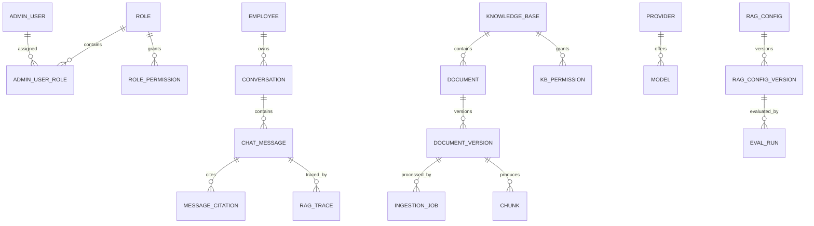

# Enterprise Agentic AI Platform

> 公共字段、状态、事件、权限与迁移映射见 [统一契约与跨版本演进规则](../../architecture/统一契约与跨版本演进规则.md)；本文件描述本版能力及增量，具体实现须通过契约与升级验收。
# 数据库与 API 设计

- 文档版本：V1.0
- 日期：2026-11-23
- 数据库：PostgreSQL（业务事实源）+ Elasticsearch（检索索引）+ Redis（短期状态/缓存）+ S3/RustFS（对象）
- 状态：MVP 逻辑设计；物理 DDL 以 Migration 为准

## 1. 设计原则

1. PostgreSQL 保存业务实体、权限关系、任务状态、配置版本、审计索引元数据。
2. Elasticsearch 只保存可检索投影，不作为业务主数据事实源。
3. Redis 不保存不可恢复的唯一业务事实。
4. 对象存储保存原件和解析产物，数据库保存对象 Key、Hash 和生命周期状态。
5. 所有主键建议 UUID；所有表包含必要的创建/更新时间和审计字段。
6. 业务 API 使用稳定 DTO，不暴露 ORM Entity 或 ES DSL。
7. ACL 在服务端计算；客户端传来的 KB ID 不是授权依据。
8. 删除采用软删除/异步清理结合；合规删除必须最终清理派生数据并保留允许保留的审计记录。
9. 时间统一 UTC 存储，API 使用 ISO 8601；展示时按用户时区转换。
10. 敏感字段加密或脱敏，密钥不以明文存库。

## 2. 逻辑数据架构



## 3. 核心表设计

### 3.1 IAM 与权限

**逻辑契约落实（2026-11-24）：** P0-04-02 以 User、ExternalIdentity 与 SubjectBinding 明确规范平台主体及既有管理员/员工来源映射，字段、状态、权限与 Schema 见 [身份与授权契约](../../api/iam-policy-contracts.md) 和 [统一契约 2.1](../../architecture/统一契约与跨版本演进规则.md#21-v10-平台主体与身份授权契约)。下列 admin_users/employees 仍保留为原逻辑设计；实际 users/identities、来源关联和 FK/唯一约束由 P1-03 在调查实际消费者后冻结，本轮没有物理表迁移。

**物理迁移落实（2026-11-25）：** P1-03 确认实际代码和本地开发库没有存量来源档案表或业务外键，采用 users/identities/subject_bindings、user_roles 及权限/审计基础表；不新建平行的 admin_users/employees/admin_user_roles。规范主体及显式来源 ID 语义保持兼容，唯一/FK、软删除、角色保护与审计追加写入约束以 [0002 迁移](../../../backend/migrations/versions/0002_iam_audit.py) 为准。调查、精确身份索引及回退边界见 [P1-03 实施记录](implementation/P1-03.md)。以下清单继续作为原逻辑设计输入，不代表当前物理 DDL。

#### `admin_users`
- `id UUID PK`
- `username VARCHAR(128) UNIQUE`
- `display_name VARCHAR(128)`
- `password_hash TEXT`
- `status VARCHAR(24)`：ACTIVE / DISABLED / LOCKED
- `last_login_at TIMESTAMPTZ`
- `created_at, updated_at, deleted_at`

#### `roles`
- `id UUID PK`
- `code VARCHAR(64) UNIQUE`
- `name VARCHAR(128)`
- `is_system BOOLEAN`
- `protected BOOLEAN`
- `created_at, updated_at`

系统角色：SUPER_ADMIN、KB_ADMIN、AUDIT_READONLY。固定角色需保护，不能删除或移除其必要权限。

#### `permissions`
- `id UUID PK`
- `code VARCHAR(128) UNIQUE`
- `resource VARCHAR(64)`
- `action VARCHAR(64)`
- `description TEXT`

#### `admin_user_roles`, `role_permissions`
- 复合唯一键防重复。
- 角色变更必须写 Audit Log。

#### `employees`
- `id UUID PK`
- `source_id VARCHAR(256)`：OAuth 来源的稳定主体 ID，敏感字段限制访问
- `display_name VARCHAR(128)`
- `login_provider VARCHAR(32)`
- `status VARCHAR(24)`：ACTIVE / PENDING_DEPARTURE / DEPARTED / DISABLED
- `pending_departure_at TIMESTAMPTZ`
- `purge_due_at TIMESTAMPTZ`
- `last_login_at TIMESTAMPTZ`
- `created_at, updated_at`

sourceId 与内部 UUID 映射应受限访问。普通 Trace 不展示姓名和 sourceId。

### 3.2 Knowledge Base 与文档

**契约落实（2026-11-24）：** 原表字段以下保留为逻辑设计输入；P0-04-03 明确 Document 生命周期/DocumentVersion 处理状态、按版本固定原件/解析引用、稳定 Job/Stage Key，以及 IndexVersion READY/Manifest/验证/发布前提，见 [知识契约](../../api/knowledge-contracts.md) 与 [统一契约 2.2](../../architecture/统一契约与跨版本演进规则.md#22-v10-知识资产入库与索引版本契约)。本轮没有物理表/列迁移，id/version、object_key 等存量映射须在实际 DDL 与消费者调查后实施。

#### `knowledge_bases`
- `id UUID PK`
- `name VARCHAR(200)`
- `description TEXT`
- `status VARCHAR(24)`：ACTIVE / DISABLED / DELETING / DELETED
- `embedding_model_id UUID`
- `active_index_version_id UUID NULL`
- `created_by UUID`
- `settings JSONB`
- `created_at, updated_at, deleted_at`

#### `kb_permissions`
- `id UUID PK`
- `kb_id UUID FK`
- `principal_type VARCHAR(24)`：ADMIN_USER / ROLE / EMPLOYEE / GROUP；规范契约增加 USER 表达平台 User.id，原来源类型/ID 继续按显式映射兼容
- `principal_id UUID`
- `permission VARCHAR(24)`：READ / MANAGE
- `created_at`
- Unique(`kb_id`, `principal_type`, `principal_id`, `permission`)

知识库管理员只读被分配 KB 的内容；超级管理员可管理。员工 Chat 的 KB 可见范围由企业业务策略确定，必须有服务端授权规则。

#### `documents`
- `id UUID PK`
- `kb_id UUID FK`
- `title VARCHAR(512)`
- `source_type VARCHAR(32)`：UPLOAD / CONNECTOR
- `object_key TEXT`
- `mime_type VARCHAR(128)`
- `file_size BIGINT`
- `file_hash CHAR(64)`
- `current_version INT`
- `status VARCHAR(24)`
- `metadata JSONB`
- `created_by UUID`
- `created_at, updated_at, deleted_at`

#### `document_versions`
- `id UUID PK`
- `document_id UUID FK`
- `version INT`
- `parser_name VARCHAR(64)`
- `parser_version VARCHAR(64)`
- `parsed_object_key TEXT`
- `chunking_config_version VARCHAR(64)`
- `status VARCHAR(24)`
- `created_at, published_at`
- Unique(`document_id`, `version`)

#### `chunks`

**契约落实（2026-11-24）：** P0-04-04 的 Chunk/ChunkMetadata/SourceLocation、完整版本引用、Parser/Retriever 契约与原字段映射见 [解析与检索契约](../../api/parsing-retrieval-contracts.md)；以下物理列仍为设计输入，跨页来源、Tokenizer 版本与父子关系须在实际 DDL/存量调查后显式落实。本轮无表/列迁移。

- `id UUID PK`
- `document_version_id UUID FK`
- `kb_id UUID`
- `chunk_index INT`
- `parent_chunk_id UUID NULL`
- `content TEXT`
- `token_count INT`
- `page_no INT`
- `heading_path JSONB`
- `source_location JSONB`
- `metadata JSONB`
- `content_hash CHAR(64)`
- `created_at`
- Unique(`document_version_id`, `chunk_index`)

Chunk 内容可以按数据量和保留策略选择 PostgreSQL 保存或仅存对象/搜索索引；若 PostgreSQL 保存，应明确删除与备份策略。ES 索引是检索投影，不能替代业务元数据。

#### `index_versions`
- `id UUID PK`
- `kb_id UUID FK`
- `version INT`
- `physical_index_name VARCHAR(255)`
- `alias_name VARCHAR(255)`
- `embedding_model_id UUID`
- `chunking_config_version VARCHAR(64)`
- `status VARCHAR(24)`：BUILDING / VALIDATING / READY / ACTIVE / ROLLED_BACK / FAILED / RETIRED；READY 表达验证完成、尚未在线
- `validation_report JSONB`
- `created_at, published_at`
- Unique(`kb_id`, `version`)

### 3.3 Ingestion

#### `ingestion_jobs`
- `id UUID PK`
- `document_version_id UUID FK`
- `job_type VARCHAR(32)`
- `stage VARCHAR(32)`
- `status VARCHAR(24)`
- `idempotency_key VARCHAR(256) UNIQUE`
- `retry_count INT`
- `progress JSONB`
- `error_code VARCHAR(64)`
- `error_message TEXT`
- `started_at, finished_at, created_at, updated_at`

#### `ingestion_job_events`
- `id UUID PK`
- `job_id UUID FK`
- `stage VARCHAR(32)`
- `event_type VARCHAR(32)`
- `details JSONB`
- `created_at`

### 3.4 Model Gateway

**契约落实（2026-11-24）：** P0-04-05 的 Provider/ModelConfig、私有 Secret/供应商引用、ModelRequest/Response/Usage 与调用规则见 [模型网关契约](../../api/model-gateway-contracts.md)。以下表字段仍为物理设计输入，密文列/Key 版本、路由标识和固定配置映射在 P2 调查实际存量后明确实施；本轮无表/列迁移，公开 DTO 不返回私有 Stored 模型。

#### `providers`
- `id UUID PK`
- `name VARCHAR(128)`
- `provider_type VARCHAR(64)`
- `base_url TEXT`
- `api_key_ciphertext TEXT`
- `api_key_key_version VARCHAR(64)`
- `timeout_seconds INT`
- `proxy_config JSONB`
- `status VARCHAR(24)`
- `created_at, updated_at`

#### `models`
- `id UUID PK`
- `provider_id UUID FK`
- `model_key VARCHAR(128)`
- `display_name VARCHAR(128)`
- `capabilities JSONB`：chat / streaming / embedding / reranker / tool_call / json_mode
- `context_window INT NULL`
- `embedding_dimension INT NULL`
- `rpm_limit INT NULL`
- `tpm_limit INT NULL`
- `max_concurrency INT NULL`
- `weight NUMERIC(6,3)`
- `is_default BOOLEAN`
- `status VARCHAR(24)`
- Unique(`provider_id`, `model_key`)

#### `model_call_logs`
记录调用元数据、耗时、Token、错误码、TraceId；不得记录明文 Key 或不必要的完整敏感 Prompt。

### 3.5 Conversation 与 Trace

会话归属、消息状态与版本化引用采用 [会话、消息与引用契约](../../api/chat-contracts.md)。下列为表设计草案，物理映射、迁移与清理按 P4 验收。

Trace、私有身份关联及 AuditEvent 的规范字段见 [Trace 与 AuditEvent 契约](../../api/trace-audit-contracts.md)。相关表的物理映射和保存规则按 P1/P5 验收。

#### `conversations`
- `id UUID PK`
- `employee_id UUID FK`
- `title VARCHAR(256)`
- `status VARCHAR(24)`
- `created_at, updated_at, deleted_at`

#### `chat_messages`
- `id UUID PK`
- `conversation_id UUID FK`
- `role VARCHAR(24)`：USER / ASSISTANT / SYSTEM
- `content TEXT`
- `status VARCHAR(24)`
- `trace_id UUID NULL`
- `token_usage JSONB`
- `created_at`

#### `message_citations`
- `id UUID PK`
- `message_id UUID FK`
- `document_id UUID`
- `document_version INT`
- `chunk_id UUID`
- `citation_order INT`
- `source_snapshot JSONB`
- Unique(`message_id`, `citation_order`)

#### `rag_traces`
- `id UUID PK`
- `trace_id UUID UNIQUE`
- `conversation_id UUID NULL`
- `message_id UUID NULL`
- `anonymous_subject_ref VARCHAR(128)`
- `source_identity_ref_ciphertext TEXT NULL`
- `status VARCHAR(24)`
- `config_version VARCHAR(64)`
- `index_version_refs JSONB`
- `summary JSONB`
- `started_at, finished_at`
- `identity_expired_at TIMESTAMPTZ NULL`

Trace 技术数据与身份映射分离。匿名 Trace 查询不应 join 出员工身份；高危溯源通过专门服务、授权和审计解密。

### 3.6 Audit 与 Lifecycle

#### `audit_logs`
- `id UUID PK`
- `actor_admin_id UUID NULL`
- `actor_role_snapshot JSONB`
- `ip_address INET NULL`
- `module VARCHAR(64)`
- `action VARCHAR(64)`
- `risk_level VARCHAR(24)`
- `object_type VARCHAR(64)`
- `object_id VARCHAR(128)`
- `result VARCHAR(24)`
- `before_snapshot JSONB`
- `after_snapshot JSONB`
- `reason TEXT NULL`
- `created_at`

审计日志不可由普通业务 API 删除。敏感快照需字段脱敏、访问受限。

#### `lifecycle_jobs`
记录待离职标记、恢复、到期清理、清理结果和关联审计事件。会话正文清理、身份映射清理、匿名指标保留和合规审计保留必须分别定义规则。

### 3.7 Evaluation

- `eval_datasets(id, name, description, version, created_by, created_at)`
- `eval_cases(id, dataset_id, question, expected_answer, ground_truth_refs JSONB, metadata JSONB)`
- `eval_runs(id, dataset_id, rag_config_version, index_version_refs JSONB, status, metrics JSONB, started_at, finished_at)`
- `eval_case_results(id, eval_run_id, eval_case_id, retrieved_refs JSONB, answer TEXT, metrics JSONB, error JSONB)`

## 4. 索引与约束建议

- 高频外键、状态和时间字段建立 B-tree 索引。
- `documents(kb_id, status)`、`ingestion_jobs(status, created_at)`、`conversations(employee_id, updated_at)`、`audit_logs(created_at, module, action)`。
- JSONB 仅用于可扩展元数据；稳定查询字段应提升为列。
- 大表按数据规模评估分区，不在 MVP 过早引入复杂分区。
- 外部 ID 与内部 UUID 分开保存。
- 删除关联应优先通过显式生命周期服务，不依赖大规模级联删除造成不可控锁和遗漏。
- 所有唯一约束和幂等键在数据库层保证，不能只靠应用层判断。

## 5. API 规范

### 5.1 通用约定

- 前缀：`/api/v1`
- JSON：UTF-8；时间 ISO 8601 UTC。
- 认证：后台 JWT；员工 OAuth 登录后由平台签发短期 Access Token + Refresh Token。
- 分页：`page, page_size` 或 cursor；列表响应统一包含 `items, total, page, page_size`。
- 错误格式：

```json
{
  "error": {
    "code": "RAG_RETRIEVAL_TIMEOUT",
    "message": "检索服务暂时不可用",
    "request_id": "uuid",
    "retryable": true,
    "details": {}
  }
}
```

- 幂等：上传、重建索引、删除、配置发布等写操作支持 `Idempotency-Key`。
- 版本：不兼容变化升主版本；新增可选字段保持兼容。
- API 层只暴露平台 DTO，不暴露 ES Query DSL、Celery Task ID 内部细节或供应商密钥。

公共 HTTP 契约的实际源码与生成制品见 [契约入口](../../api/README.md)，`make contracts` / `make contracts-check` 生成与核对当前真实 OpenAPI、JSON Schema 和前端类型。当前分页输入默认 page=1、page_size=20，page_size 上限 100；此为 HTTP 输入边界，不代表 MVP 容量/并发门槛已确认。业务列表、身份登录和下述 API 清单仍按对应主线任务交付。

## 6. API 清单（MVP）

### 6.1 Authentication / IAM

| Method | Path | 说明 | 权限 |
|---|---|---|---|
| POST | `/auth/admin/login` | 后台登录 | Public |
| POST | `/auth/refresh` | 刷新 Token | Authenticated |
| POST | `/auth/logout` | 登出/撤销 Refresh | Authenticated |
| GET | `/auth/me` | 当前身份与权限 | Authenticated |
| GET/POST | `/admin/users` | 后台用户列表/创建 | SUPER_ADMIN；审计只读列表 |
| PATCH/DELETE | `/admin/users/{id}` | 修改/删除用户 | SUPER_ADMIN |
| GET/POST | `/admin/roles` | 角色列表/创建自定义角色 | SUPER_ADMIN |
| PATCH | `/admin/roles/{id}` | 修改角色权限 | SUPER_ADMIN |
| GET | `/admin/permissions` | 权限目录 | SUPER_ADMIN |
| GET | `/employees` | 员工列表 | SUPER_ADMIN / AUDIT_READONLY |
| POST | `/employees/{id}/pending-departure` | 标记待离职 | SUPER_ADMIN |
| POST | `/employees/{id}/restore` | 恢复正常 | SUPER_ADMIN |

员工 OAuth 回调路径按所选供应商确定；平台统一映射为内部 Employee。

### 6.2 Provider / Model

| Method | Path | 说明 |
|---|---|---|
| GET/POST | `/admin/providers` | 供应商列表/创建 |
| GET/PATCH/DELETE | `/admin/providers/{id}` | 供应商详情/修改/删除 |
| GET/POST | `/admin/providers/{id}/models` | 模型列表/注册 |
| PATCH/DELETE | `/admin/models/{id}` | 模型修改/删除 |
| POST | `/admin/models/{id}/health-check` | 健康检查 |
| GET | `/admin/model-calls` | 调用统计/日志摘要 |

Key 写入只接受创建/更新，不提供明文读取 API；列表只返回掩码状态。

### 6.3 Knowledge Base / Document / Ingestion

| Method | Path | 说明 |
|---|---|---|
| GET/POST | `/admin/knowledge-bases` | KB 列表/创建 |
| GET/PATCH/DELETE | `/admin/knowledge-bases/{kb_id}` | KB 详情/修改/删除 |
| GET/PUT | `/admin/knowledge-bases/{kb_id}/permissions` | KB 权限管理 |
| POST | `/admin/knowledge-bases/{kb_id}/documents` | 上传文档 |
| GET | `/admin/knowledge-bases/{kb_id}/documents` | 文档列表 |
| GET | `/admin/documents/{document_id}` | 文档详情 |
| POST | `/admin/documents/{document_id}/reprocess` | 重解析/重切片/重建 |
| DELETE | `/admin/documents/{document_id}` | 删除文档 |
| GET | `/admin/ingestion-jobs/{job_id}` | 任务状态 |
| GET | `/admin/ingestion-jobs/{job_id}/events` | 任务阶段事件 |
| POST | `/admin/knowledge-bases/{kb_id}/index-versions` | 构建新索引版本 |
| POST | `/admin/index-versions/{id}/validate` | 验证索引 |
| POST | `/admin/index-versions/{id}/publish` | 发布/切换 alias |
| POST | `/admin/index-versions/{id}/rollback` | 回滚 |

上传采用 multipart 或预签名 URL；文件内容不经普通 JSON API 传输。所有接口执行后台角色和 KB 级权限检查。

### 6.4 Chat / RAG

| Method | Path | 说明 |
|---|---|---|
| POST | `/chat/conversations` | 创建会话 |
| GET | `/chat/conversations` | 当前员工会话列表 |
| GET | `/chat/conversations/{id}` | 会话详情（仅本人） |
| DELETE | `/chat/conversations/{id}` | 删除本人会话 |
| POST | `/chat/conversations/{id}/messages` | 提问，SSE 流式响应 |
| POST | `/chat/messages/{id}/feedback` | 反馈 |
| GET | `/chat/messages/{id}/citations` | 引用详情 |
| GET | `/chat/messages/{id}/trace-id` | 获取可复制 TraceId |

SSE `POST /messages` 请求示例：

```json
{
  "content": "公司的差旅报销标准是什么？",
  "kb_ids": ["uuid"],
  "stream": true
}
```

服务端从登录态解析可访问 KB；`kb_ids` 仅表示用户选择意图，不代表授权。

### 6.5 Trace / Audit / Evaluation

| Method | Path | 说明 | 权限 |
|---|---|---|---|
| GET | `/admin/traces/{trace_id}` | 匿名 Trace 详情 | SUPER_ADMIN / AUDIT_READONLY |
| POST | `/admin/traces/{trace_id}/reveal-identity` | 高危溯源 | SUPER_ADMIN + reason + MFA/二次确认 |
| GET | `/admin/audit-logs` | 审计日志 | SUPER_ADMIN / AUDIT_READONLY |
| GET/POST | `/admin/eval/datasets` | Dataset 列表/创建 | SUPER_ADMIN |
| POST | `/admin/eval/datasets/{id}/import` | 导入样本 | SUPER_ADMIN |
| POST | `/admin/eval/runs` | 启动评测 | SUPER_ADMIN |
| GET | `/admin/eval/runs/{id}` | 评测报告 | SUPER_ADMIN / 授权只读 |
| POST | `/admin/rag-configs/{id}/evaluate` | 对配置执行评测 | SUPER_ADMIN |
| POST | `/admin/rag-configs/{id}/publish` | 发布配置 | SUPER_ADMIN |

### 6.6 Agent Runtime（预留 / 第二阶段）

| Method | Path | 说明 |
|---|---|---|
| GET/POST | `/admin/agents` | Agent 列表/创建 |
| GET/PATCH | `/admin/agents/{id}` | Agent 详情/修改草稿 |
| POST | `/admin/agents/{id}/versions` | 创建版本 |
| POST | `/admin/agents/{id}/publish` | 发布版本 |
| POST | `/agents/{id}/runs` | 发起 Agent Run |
| GET | `/agents/runs/{run_id}` | Run 状态 |
| POST | `/agents/runs/{run_id}/cancel` | 取消 |
| POST | `/agents/runs/{run_id}/approvals/{approval_id}` | 审批动作 |

MVP 可不开放这些接口；如提前实现，仅允许内部实验权限。

## 7. 角色与权限矩阵（概要）

| 功能 | SUPER_ADMIN | KB_ADMIN | AUDIT_READONLY | Employee |
|---|---|---|---|---|
| 仪表盘 | 读 | 读（聚合范围需定义） | 读 | - |
| Provider / Model | 管理 | 不可见 | 只读 | - |
| KB | 全管理 | 分配范围只读 | 只读 | 按业务策略问答 |
| Document | 全管理 | 分配范围只读 | 只读 | 仅检索可见内容 |
| Trace | 匿名查询 + 高危溯源 | 不可见 | 匿名只读 | 自己 Chat 卡片 TraceId |
| Admin Users / Roles | 管理 | 不可见 | 只读（按既定原型） | - |
| Employee Lifecycle | 管理 | 不可见 | 只读 | 查看自身必要信息 |
| Audit | 读 | 不可见 | 读 | - |
| Chat | - | - | - | 本人会话 |

需注意：角色矩阵是后台管理权限，不自动等价于员工对知识内容的访问权限。

**实施落实（2026-11-25）：** [P1-05](implementation/P1-05.md) 通过 0004 迁移冻结 23 项操作与三个固定角色关系，审计员按本节可读角色/权限目录；自定义角色仅可委派只读操作。KB 内容使用目的隔离的显式 Grant，超级管理员也无隐式内容范围；不可委派的 acl.manage 负责显式授权/撤权。当前只实现授权范围 ID，KB 实体及资源 FK 随 P2-03 补齐，未提前实现知识库 CRUD。

## 8. 数据生命周期规则

- 标记待离职：立即阻止登录及新请求，设置 7 天缓冲期。
- 缓冲期内恢复：清除待离职标记，恢复授权；恢复行为写审计。
- 到期：自动清理会话正文、消息、引用及身份关联，按策略使关联 Trace 身份映射失效。
- 匿名性能指标和不可逆匿名化统计可按保留策略留存。
- 合规审计日志不可因用户会话清理而删除，但需避免保留超出必要范围的个人信息。
- 用户删除自己的会话时，执行同一套清理服务；不提供后台随意批量清除会话入口。
- 删除失败进入重试与告警，不得把“已发起删除”显示为“已彻底删除”。

## 9. 迁移、备份与恢复

- 使用 Alembic 管理 PostgreSQL Migration。
- Migration 向前兼容：先加列/新表，再迁移数据，最后移除旧结构。
- 备份 PostgreSQL、对象存储元数据和配置；ES 可由业务数据与索引版本重建。
- 恢复演练覆盖 DB + Object Storage + ES alias 版本一致性。
- 密钥加密密钥与数据库备份分离管理。

## 10. 跨版本演进补充

本版 eval_* 保持 V1.0 命名；V1.2 evaluation_* 必须通过统一契约规则中的 Dataset/Case/Run/Result 映射承接历史数据和接口。历史 RAG 评测保持 RAG 配置/索引快照，不能填造 Agent Version。身份适配保留 admin_users/employees 到可信平台主体的映射，不假定与后续 users 的 UUID 相同。

所有版本按单企业部署，资源沿用现有用户/组织/KB ACL；稳定 ID、父子关系与普通版本兼容迁移继续保留，授权变更覆盖派生数据。本文逻辑清单经迁移脚本实现后才属于物理 DDL。
