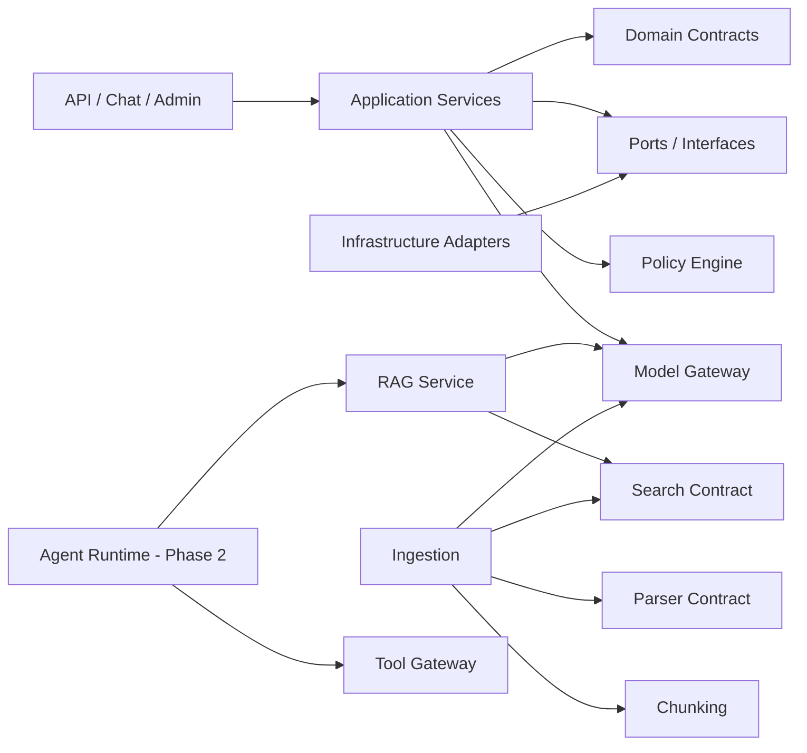
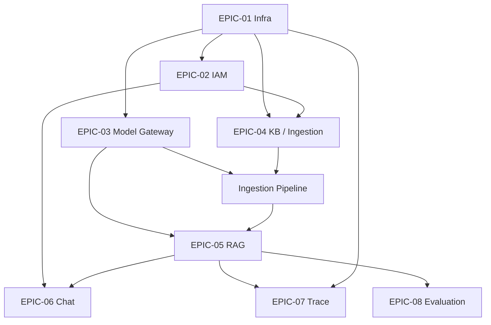

# Enterprise Agentic AI Platform

> 公共字段、状态、事件、权限与迁移映射见 [统一契约与跨版本演进规则](../../architecture/统一契约与跨版本演进规则.md)；本文件描述本版能力及增量，具体实现须通过契约与升级验收。
# 项目代码结构及研发任务拆分

- 文档版本：V1.0
- 日期：2026-11-23
- 目标：第一期企业级 Standard RAG MVP 闭环；保留 Agent Runtime 扩展边界
- 组织方式：Monorepo；模块化单体 + 独立异步 Worker；Vite + React + TypeScript 的 Chat/Admin 两个独立应用

## 1. 工程原则

1. 先模块化单体，不为未来想象提前拆微服务。
2. 领域模块通过 Application Service / Contract 交互，不跨模块直接访问对方 Repository。
3. LlamaIndex、LangGraph、LiteLLM、Docling、Elasticsearch 均通过 Adapter 隔离。
4. PostgreSQL 是业务事实源；ES 是检索投影；Redis 是短期状态；对象存储放文件。
5. 所有外部调用有超时、限流、错误分类、Trace。
6. 每个异步任务必须幂等、可重试、可观测。
7. API、数据库、事件和模型调用 Contract 先定义，再并行开发。
8. 单元测试 + 集成测试 + Golden Dataset + 安全测试共同构成质量门禁。

## 2. 推荐 Monorepo 结构

```text
enterprise-agent-platform/
├── README.md
├── package.json                 # pnpm workspace 根入口
├── pnpm-workspace.yaml
├── pnpm-lock.yaml
├── pyproject.toml
├── uv.lock
├── .env.example
├── docker-compose.yml
├── Makefile
├── docs/
│   ├── architecture/
│   ├── adr/
│   ├── api/
│   ├── runbooks/
│   └── product/
├── backend/
│   ├── pyproject.toml
│   ├── app/
│   │   ├── main.py
│   │   ├── core/
│   │   │   ├── config.py
│   │   │   ├── logging.py
│   │   │   ├── errors.py
│   │   │   ├── security.py
│   │   │   ├── telemetry.py
│   │   │   └── dependencies.py
│   │   ├── api/
│   │   │   ├── v1/router.py
│   │   │   ├── middleware/
│   │   │   └── schemas/
│   │   ├── modules/
│   │   │   ├── iam/
│   │   │   ├── policy/
│   │   │   ├── users/
│   │   │   ├── providers/
│   │   │   ├── model_gateway/
│   │   │   ├── knowledge_base/
│   │   │   ├── documents/
│   │   │   ├── ingestion/
│   │   │   ├── parsing/
│   │   │   ├── chunking/
│   │   │   ├── embedding/
│   │   │   ├── search/
│   │   │   ├── rag/
│   │   │   ├── conversations/
│   │   │   ├── traces/
│   │   │   ├── audit/
│   │   │   ├── lifecycle/
│   │   │   ├── evaluation/
│   │   │   └── agent_runtime/   # 第二阶段，先放契约/接口
│   │   ├── adapters/
│   │   │   ├── db/
│   │   │   ├── redis/
│   │   │   ├── object_storage/
│   │   │   ├── elasticsearch/
│   │   │   ├── llama_index/
│   │   │   ├── docling/
│   │   │   ├── mineru/
│   │   │   ├── litellm/
│   │   │   ├── celery/
│   │   │   └── phoenix/
│   │   └── workers/
│   │       ├── celery_app.py
│   │       └── tasks/
│   ├── migrations/
│   └── tests/
│       ├── unit/
│       ├── integration/
│       ├── contract/
│       ├── security/
│       └── e2e/
├── frontend/
│   ├── apps/
│   │   ├── chat/
│   │   │   ├── package.json
│   │   │   ├── vite.config.ts
│   │   │   ├── .env.example
│   │   │   ├── src/
│   │   │   │   ├── app/
│   │   │   │   ├── routes/
│   │   │   │   ├── features/chat/
│   │   │   │   ├── stores/
│   │   │   │   └── styles/
│   │   │   └── tests/
│   │   └── admin/
│   │       ├── package.json
│   │       ├── vite.config.ts
│   │       ├── .env.example
│   │       ├── src/
│   │       │   ├── app/
│   │       │   ├── routes/
│   │       │   ├── features/
│   │       │   │   ├── dashboard/
│   │       │   │   ├── providers/
│   │       │   │   ├── knowledge-bases/
│   │       │   │   ├── documents/
│   │       │   │   ├── traces/
│   │       │   │   ├── users/
│   │       │   │   ├── roles/
│   │       │   │   ├── audit/
│   │       │   │   ├── evaluation/
│   │       │   │   └── settings/
│   │       │   ├── stores/
│   │       │   └── styles/
│   │       └── tests/
│   └── packages/
│       ├── ui/                   # package.json + src，公共组件
│       ├── api-client/           # 后端 OpenAPI 生成类型与请求封装
│       └── shared/               # 公共工具与类型
├── infra/
│   ├── docker/
│   ├── compose/
│   ├── elasticsearch/
│   ├── rustfs/
│   ├── rabbitmq/
│   ├── observability/
│   └── scripts/
├── eval/
│   ├── datasets/
│   ├── runners/
│   ├── metrics/
│   └── reports/
└── .github/workflows/
```

Chat/Admin 应用分离与工具选择依据 [ADR-0014](../../adr/0014-monorepo-and-independent-frontend-apps.md)。前端 pnpm workspace 在根目录声明 `frontend/apps/*` 与 `frontend/packages/*`，使用统一 pnpm 锁文件；Python 依赖由 uv 与实际 pyproject.toml/uv.lock 管理，不通过 pnpm 安装。

两个前端各自拥有 Vite 入口、路由、环境配置、构建产物与部署目标，共用后端 API。公共包维护显式导出，依赖方向为应用 → 公共包；公共包不依赖应用，两个应用不直接导入彼此源码。登录、API 地址与跨应用跳转按真实环境配置，状态和权限以既有后端契约为准。

CI 按受影响的应用、公共包和后端模块执行检查；公共包变更覆盖其消费者，API 契约变更检查生成客户端及对应应用。具体脚本、包名、版本和启动命令在实际源码仓落地；示例目录不代表源码已经初始化。

前端组件、Hook、状态、样式和流式交互按 [前端代码规范](../../standards/前端代码规范.md) 实现；本文件维护工程结构，组件规则在该规范维护。

后端分层、类型、授权、事务、Worker 与异常处理按 [后端代码规范](../../standards/后端代码规范.md) 实现；模块功能、契约与任务范围继续依据本版详设和统一契约。

### 2.1 单个模块内部结构

```text
modules/rag/
├── domain/
│   ├── entities.py
│   ├── value_objects.py
│   ├── contracts.py
│   └── errors.py
├── application/
│   ├── query_service.py
│   ├── query_router.py
│   └── context_budget.py
├── infrastructure/
│   └── repositories.py
├── api/
│   └── routes.py
└── tests/
```

- `domain` 不依赖 FastAPI、LlamaIndex、ES。
- `application` 编排用例，依赖接口。
- `infrastructure/adapters` 实现接口。
- `api` 负责 HTTP DTO 和权限依赖，不放核心业务逻辑。

## 3. 模块依赖规则



禁止：
- API Router 直接调用 ES / LiteLLM / Docling。
- Agent 直接连接 ES 或业务数据库。
- 前端自行判断 ACL 并将其作为安全边界。
- 模块之间读取对方 ORM Model / 私有 Repository。
- Celery Task 承载复杂业务规则；Task 应调用 Application Service。

## 4. 关键 Contract 优先冻结

在并行开发前先冻结以下接口：
1. `ParsedDocument` / `ParsedBlock`。
2. `Chunk` / `ChunkMetadata` / `SourceLocation`。
3. `IngestionJob` 状态与事件协议。
4. `IndexVersion` 发布、回滚和状态机。
5. `AccessContext` / Policy Decision。
6. `RetrievalRequest` / `RetrievalResult`。
7. `ModelGateway` Chat / Stream / Embedding / Rerank。
8. Chat SSE 事件。
9. `TraceContext` / Span Attribute Schema。
10. API Error Schema 与分页规范。

## 5. 研发 Epic 与任务拆分

优先级：
- **P0**：MVP 闭环不可缺少。
- **P1**：第一期验收建议包含，允许按团队容量分批交付。
- **P2**：第二阶段或后续增强。

### EPIC-01 工程底座与基础设施（P0）

| ID | 任务 | 交付物 / 验收 |
|---|---|---|
| INF-001 | Monorepo、uv、pnpm workspace、Vite React TS 双应用初始化 | 后端与 Chat/Admin 可分别启动/构建，公共包解析与格式化/静态检查通过 |
| INF-002 | Docker Compose 环境 | PostgreSQL、Redis、ES、RabbitMQ、RustFS 健康检查 |
| INF-003 | Alembic Migration | 可升级/回滚开发数据库 |
| INF-004 | 对象存储 Adapter | 上传、下载、删除、预签名 URL |
| INF-005 | Redis Adapter | TTL、缓存封装、连接健康 |
| INF-006 | Celery Worker | 队列、任务注册、健康与失败状态 |
| INF-007 | 全局异常与错误码 | 统一 Error Schema |
| INF-008 | API 规范与 OpenAPI | 分页、鉴权、请求 ID、版本 |
| INF-009 | 配置与 Secret 管理 | 环境变量、密钥加密、无明文日志 |
| INF-010 | CI | Lint、Type Check、Unit Test、Build |
| INF-011 | OTel 基础接入 | API、Worker Trace Context 贯通 |

### EPIC-02 身份认证与权限（P0）

| ID | 任务 | 交付物 / 验收 |
|---|---|---|
| IAM-001 | 后台登录与 JWT | Access/Refresh、撤销、密码 Hash |
| IAM-002 | 后台用户 CRUD | 创建、编辑、禁用、重置、删除 |
| IAM-003 | RBAC | 固定三角色 + 自定义角色 |
| IAM-004 | API / 菜单 / 操作权限 | 后端强制校验 |
| IAM-005 | 员工 OAuth | 首期接入一种身份源，Adapter 可扩展 |
| IAM-006 | Employee 身份映射 | sourceId 与内部 UUID 分离 |
| IAM-007 | 员工状态机 | ACTIVE / PENDING_DEPARTURE / DEPARTED |
| IAM-008 | KB ACL | KB / Document 权限上下文 |
| IAM-009 | 越权测试 | API、检索、Trace、调试接口覆盖 |

### EPIC-03 Provider 与 Model Gateway（P0）

| ID | 任务 | 交付物 / 验收 |
|---|---|---|
| MOD-001 | Provider CRUD | API 地址、Key、超时、代理、状态 |
| MOD-002 | Key 加密与掩码 | 无明文读取和日志 |
| MOD-003 | Model Registry | Chat / Embedding / Reranker Capability |
| MOD-004 | Provider Adapter + LiteLLM | 统一调用 Facade |
| MOD-005 | Chat / Streaming API | 错误映射和流式事件 |
| MOD-006 | Embedding API | 批量、维度校验、批次拆分 |
| MOD-007 | Reranker API | 统一排序 Contract |
| MOD-008 | RPM / TPM / 并发限流 | 模型级限制 |
| MOD-009 | Retry / Timeout / Fallback | 可观测且不重复副作用 |
| MOD-010 | Model Call Log | Token、耗时、错误、Trace |

### EPIC-04 Knowledge Base 与 Ingestion（P0）

| ID | 任务 | 交付物 / 验收 |
|---|---|---|
| KB-001 | KB CRUD 与配置 | 状态、Embedding、统计 |
| KB-002 | KB 权限管理 | 权限校验与审计 |
| DOC-001 | 上传与文件校验 | Hash、MIME、大小、重复 |
| DOC-002 | Document Version | 版本与对象存储 |
| ING-001 | Ingestion Job 状态机 | 任务状态、事件、进度 |
| ING-002 | Parser Adapter | Docling 默认、MinerU 可插拔 |
| ING-003 | Normalizer | ParsedDocument 标准化 |
| ING-004 | Structure-aware Chunker | Parent/Child、Metadata |
| ING-005 | ACL Metadata 传递 | 权限标签可检索过滤 |
| ING-006 | Embedding Pipeline | Model Gateway 批量向量化 |
| ING-007 | ES Index Adapter | Dense + BM25 Mapping |
| ING-008 | Index Version Manager | 新版本构建、验证、发布、回滚 |
| ING-009 | 幂等与断点恢复 | 重复消息不重复产物 |
| ING-010 | Delete Pipeline | 原件/解析/Chunk/索引/缓存清理 |
| ING-011 | Job Monitor API/UI | 失败原因和阶段可见 |

### EPIC-05 Standard RAG Engine（P0）

| ID | 任务 | 交付物 / 验收 |
|---|---|---|
| RAG-001 | Query Router | 普通知识问答默认路由 |
| RAG-002 | Conversation Context | 多轮上下文和指代 |
| RAG-003 | Query Rewrite | 可配置、可追踪 |
| RAG-004 | Retriever Contract | 与 ES 解耦 |
| RAG-005 | Dense Retrieval | ACL / Metadata Filter |
| RAG-006 | BM25 Retrieval | 关键词召回 |
| RAG-007 | RRF Fusion | 可配置参数 |
| RAG-008 | Reranker Adapter | 统一模型接口 |
| RAG-009 | Parent Context Expansion | 证据上下文补全 |
| RAG-010 | Context Budget Manager | Token 预算与裁剪 Trace |
| RAG-011 | Prompt Versioning | 模板、版本、发布 |
| RAG-012 | LLM Generation + SSE | 流式回答 |
| RAG-013 | Citation Generation / Validation | 引用只能来自检索证据 |
| RAG-014 | No-answer / Confidence Policy | 无证据拒答 |
| RAG-015 | Feedback | 有帮助/无帮助与原因 |
| RAG-016 | Prompt Injection 防护 | 文档和输入均视为不可信 |
| RAG-017 | Retrieval Diagnostics | 各阶段候选与分数可查 |
| RAG-018 | Failure Classification | 超时、无召回、模型失败等 |

### EPIC-06 Employee Chat（P0）

| ID | 任务 | 交付物 / 验收 |
|---|---|---|
| CHAT-001 | Chat 主页面 | 对话列表 + 主聊天区 |
| CHAT-002 | OAuth 登录态 | 员工身份与权限 |
| CHAT-003 | SSE 客户端 | 断线、错误、完成状态 |
| CHAT-004 | 引用 UI | 文档、页码、摘录 |
| CHAT-005 | 会话历史 | 仅本人可见 |
| CHAT-006 | 新建/删除会话 | 调用 Lifecycle Service |
| CHAT-007 | TraceId 展示/复制 | 每条问答可复制 |
| CHAT-008 | 反馈组件 | 提交反馈 |
| CHAT-009 | 错误与空状态 | 无权限、无证据、服务不可用 |

### EPIC-07 Trace、审计与运维（P0）

| ID | 任务 | 交付物 / 验收 |
|---|---|---|
| OBS-001 | OTel Trace / Span 规范 | API 到 Worker / Model 全链路 |
| OBS-002 | Phoenix 集成 | Trace 浏览 |
| OBS-003 | 平台 Trace Metadata | 自有查询 API 和元数据 |
| OBS-004 | 匿名 Trace UI | TraceId 查询，无用户筛选 |
| OBS-005 | 高危溯源 | 超级管理员、理由、二次确认、审计 |
| AUD-001 | Audit Log | 前后变更、操作人、风险等级 |
| AUD-002 | Audit UI | 查询、筛选、详情，不可删除 |
| LIFE-001 | 待离职与恢复 | 立即阻断、7 天缓冲 |
| LIFE-002 | 自动清理任务 | 会话、身份映射、Trace 关联规则 |
| LIFE-003 | 删除结果审计 | 失败重试和告警 |
| ADM-001 | Dashboard | 调用、Token、失败率、趋势 |
| ADM-002 | Provider UI | CRUD、模型子表 |
| ADM-003 | KB / Document UI | 上传、状态、索引操作 |
| ADM-004 | User / Role UI | 角色与员工生命周期 |
| ADM-005 | Config Center | 受控配置，不可绕过生命周期策略 |

### EPIC-08 Evaluation 与检索调试（基础评测 P0；扩展实验 P1）

EVAL-001–007 和 EVAL-010 的最小 Dataset、Runner、适用检索/回答/引用指标、报告与回归门禁是 P0；适用语义指标通过 RAGAS Adapter 接入并固定版本。EVAL-008 最小检索调试按架构 V1.0 范围交付，EVAL-009 复杂参数实验及更多指标为 P1。

| ID | 任务 | 交付物 / 验收 |
|---|---|---|
| EVAL-001 | Golden Dataset 模型 | 问题、标准答案、Ground Truth |
| EVAL-002 | Dataset CRUD / Import | CSV / Excel 导入与版本 |
| EVAL-003 | Batch Eval Runner | 批量执行、任务状态 |
| EVAL-004 | Retrieval Metrics | Recall@K、MRR、NDCG |
| EVAL-005 | Answer Metrics | Faithfulness、Answer Relevancy |
| EVAL-006 | Citation Accuracy | 引用命中率与可验证性 |
| EVAL-007 | Eval Report | 配置版本对比 |
| EVAL-008 | 单问题检索调试台 | Dense / BM25 / RRF / Rerank / Context |
| EVAL-009 | 参数实验 | 参数独立调整、保存实验 |
| EVAL-010 | 配置发布/回滚 | 评测门禁和版本记录 |

## 6. 研发依赖与并行关系



可并行：
- 前端 Chat/Admin 可基于冻结的 OpenAPI Mock 先行。
- Parser、Chunker、ES Adapter 可并行，但 ParsedDocument / Chunk / Job Contract 必须先冻结。
- Model Gateway 与 IAM 可并行。
- Trace SDK 与业务模块并行推进，但 Span Schema 需提前统一。
- Evaluation UI 可先做 Dataset 管理，Runner 等 RAG Contract 稳定后接入。

## 7. 建议 Sprint 规划（6 × 2 周，需按团队规模调整）

| Sprint | 目标 | 主要交付 |
|---|---|---|
| S1 | 工程底座与身份骨架 | Monorepo、Docker、DB Migration、JWT、RBAC 框架、OpenAPI |
| S2 | 模型配置与 KB 基础 | Provider/Model CRUD、Model Gateway 首条链路、KB CRUD、上传 |
| S3 | 文档入库闭环 | Parser、Chunker、Embedding、ES、Ingestion Job、索引版本 |
| S4 | RAG 与 Chat 闭环 | Hybrid Retrieval、Reranker、Context Budget、SSE、Citation、多轮 |
| S5 | 企业治理与运维 | Trace、Audit、权限测试、员工 OAuth、离职生命周期、Admin 页面 |
| S6 | 质量评测与上线准备 | Golden Dataset、检索调试台、回归、性能/安全测试、部署演练 |

该计划是排期模板，不是工期承诺。若只有 3–4 人，应减少一期范围或增加 Sprint，不应通过跳过 ACL、删除、引用验证和 Trace 来压缩时间。

## 8. 建议团队角色

6–8 人参考：
- 1 技术负责人/架构师：Contract、架构、ADR、代码评审、风险控制。
- 2 Python 后端：IAM、API、DB、Ingestion、Lifecycle、Audit。
- 2 AI/RAG 工程师：Parser、Chunking、Search、RAG、Evaluation。
- 2 前端：Chat、Admin、Trace / Evaluation UI。
- 1 QA / 测试工程师：自动化、权限、安全、端到端、回归。
- DevOps 可由技术负责人或后端兼任，生产部署前需明确责任人。

## 9. Definition of Done

每个任务完成需满足：
- Contract / API / Migration 更新并评审。
- 单元测试覆盖主要逻辑和边界。
- 集成测试覆盖外部依赖 Adapter。
- 权限与数据生命周期场景有测试。
- 日志、Trace、错误码齐全，不泄露密钥或敏感信息。
- 文档和运维说明更新。
- 前端具备 Loading / Empty / Error / Permission Denied 状态。
- 代码通过 Lint、Type Check、CI。
- 关键配置可追溯版本，必要时具备回滚路径。

## 10. MVP 明确不做

- 复杂 LangGraph Planner / Multi-Agent。
- MCP Server 管理 UI（只预留 Tool Contract）。
- GraphRAG、多模态检索。
- Temporal / Kafka。
- 自建 GPU 推理集群。
- 复杂长期 Memory。
- 复杂自动化工作流编排。
- 全面微服务化。

## 11. MVP 发布门禁

### 功能
- 管理员配置至少一个 Chat 模型和一个 Embedding 模型。
- KB CRUD、权限、文档上传、异步解析、切片、Embedding、索引。
- 索引版本验证、发布、回滚。
- Dense + BM25 + RRF + Reranker。
- 员工登录、多轮 Chat、SSE、真实引用、反馈、会话管理。
- TraceId 可定位检索、模型、Prompt、Token、耗时和错误。
- Golden Dataset 批量评测和配置对比。

### 安全
- 后端 RBAC 与 KB ACL 生效。
- 越权检索为零容忍。
- API Key 加密与掩码。
- Trace 默认匿名，高危溯源受控。
- 待离职立即阻断，7 天后自动清理符合策略。
- Prompt Injection、敏感信息、删除残留有测试。

### 可靠性与性能
- Ingestion 幂等、重试、断点恢复。
- 模型调用超时、限流和错误分类。
- Worker 可独立扩容。
- P95、并发、批量入库吞吐、队列积压阈值在 POC 后确定并签署。
- 备份恢复与索引重建完成演练。

## 12. 开发顺序的关键提醒

不要先把 Admin 页面做完整，再回头补底层。优先冻结领域模型与 Contract，尽早打通一条纵向业务切片：

**管理员配置模型 → 创建 KB → 上传一份文档 → Parser → Chunk → Embedding → ES 索引 → 员工提问 → Hybrid Retrieval → LLM 回答 → Citation → Trace。**

这条链路跑通后，再扩展批量任务、治理页面、评测与更多管理能力。它是第一期最重要的集成里程碑。
