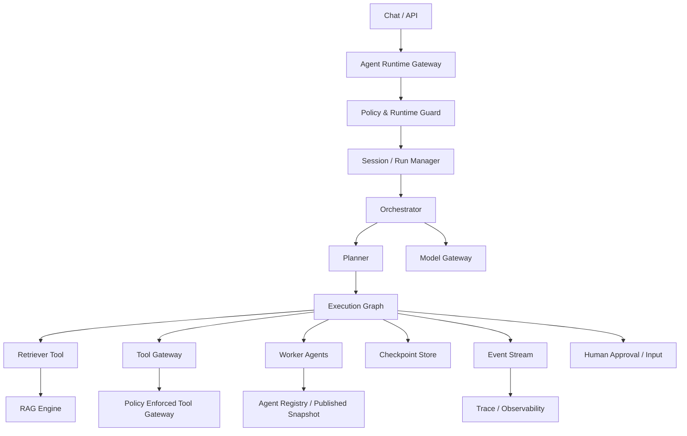

# V1.3-01 Advanced Agent Runtime 与执行架构详细设计

> 公共字段、状态、事件、权限与迁移映射见 [统一契约与跨版本演进规则](../../architecture/统一契约与跨版本演进规则.md)；本文件描述本版能力及增量，具体实现须通过契约与升级验收。

## 1. 文档目标

定义 V1.3 高级 Agent 执行能力的架构、边界、状态模型、运行语义和工程约束。V1.3 在 V1.1 Agent Runtime、V1.2 Agent Registry / Definition / Playground / Evaluation / Release 的基础上增强，不重写既有运行时。

## 2. 版本目标与非目标

### 2.1 目标
- 支持复杂任务的计划生成、任务拆解、执行、观察、重规划和最终综合。
- 支持多步工具调用与 RAG 检索，并保留完整证据链。
- 支持 Supervisor-Worker 风格的受控 Multi-Agent 协作。
- 支持 Checkpoint、Retry、Resume、Cancel、Timeout 和人工介入。
- 支持运行预算、最大步骤、最大 Agent 深度、并发和成本控制。
- 支持端到端 Trace、执行事件、审计和 Evaluation。

### 2.2 非目标
- 不建设企业级 Workflow Designer 或通用 BPMN 引擎。
- 不允许 Agent 无约束地执行高风险业务写操作。
- 不在 V1.3 实现开放式 Agent Marketplace。
- 不默认启用无限递归 Agent、无限并行或无上限自我反思。
- 不把 Multi-Agent 当作所有问题的默认执行模式。

## 3. 总体架构



核心原则：
1. Runtime 只加载已发布的不可变 Agent Version Snapshot。
2. Agent 执行所有外部能力都经过 Tool Gateway / Retriever Contract。
3. Policy 在工具执行前再次判定，不信任 Prompt 中的权限声明。
4. 执行状态与事件分离：状态用于恢复，事件用于审计、实时 UI 和分析。
5. 模型输出是非可信输入，Planner 结果必须经过 Schema、Policy 和预算校验。

## 4. 核心执行模型

一次用户请求创建一个 `AgentRun`。Run 可包含多个 `Plan`，每个 Plan 包含有依赖关系的 `Task`；Task 可由当前 Agent 执行，也可委派给允许的 Worker Agent。每个 Task 产生一个或多个 `Step`。Step 是最小可观测执行单元，可为 LLM 调用、Retriever 调用、Tool 调用、Agent Delegation、Human Wait 或 Verification。

建议实体：
- `agent_run`: 一次运行的生命周期容器。
- `agent_plan`: 某一轮计划及版本。
- `agent_task`: 计划中的任务节点及依赖。
- `agent_step`: 实际执行步骤。
- `agent_checkpoint`: 可恢复状态快照。
- `agent_event`: 按序追加的运行事件。
- `agent_artifact`: 文件、表格、结构化结果、证据集合等产物。
- `agent_handoff`: 父子 Agent 委派关系。
- `human_interaction`: 人工审批或补充输入记录。

## 5. Run 状态机与执行阶段

公共 status 沿用 V1.1/V1.2：QUEUED、ACCEPTED、RUNNING、WAITING_APPROVAL、WAITING_INPUT、CANCEL_REQUESTED、SUCCEEDED、FAILED、CANCELLED、TIMED_OUT；V1.3 显式增加 PAUSED。

```text
QUEUED -> ACCEPTED -> RUNNING -> SUCCEEDED / FAILED / TIMED_OUT
                       |  ^
                       v  |
           WAITING_APPROVAL / WAITING_INPUT / PAUSED
活动状态 -> CANCEL_REQUESTED -> CANCELLED
```

INITIALIZING / PLANNING / PLAN_VALIDATING / EXECUTING / VERIFYING / SYNTHESIZING / REPLANNING / RETRYING 使用 execution_phase，不替换公共 status。WAITING_FOR_HUMAN 仅为 UI 聚合名称：审批映射 WAITING_APPROVAL，澄清/复核映射 WAITING_INPUT，并记录 waiting_reason、截止时间和允许动作。

- 旧消费者未知 PAUSED 时安全呈现不可执行等待状态并回查；不得自动继续或写入旧状态。
- 终态纠错创建关联原 Run 的新 Run；Resume Attempt 仅用于允许恢复的非终态 Run。
- 用户取消停止派发新 Step，尽力取消可取消调用并持久化最终状态。
- Timeout 分为 Run/Task/Step/Tool 四级，内层不得覆盖更严格的外层 Deadline。
- 状态迁移、幂等和恢复规则以统一契约第 4 节为准。

## 6. Planner 设计

Planner 输入：
- 用户目标及当前对话必要上下文
- Agent Definition Snapshot
- 可用 Tool / Retriever 的名称、Schema、权限摘要
- 当前运行预算和策略
- 相关 Memory（按策略筛选）
- 已有证据和执行历史（重规划时）

Planner 输出必须是结构化 JSON，禁止直接执行工具。建议 Schema：

```json
{
  "goal": "string",
  "tasks": [
    {
      "task_id": "string",
      "description": "string",
      "task_type": "retrieve|analyze|tool|delegate|verify|synthesize",
      "dependencies": [],
      "required_capabilities": [],
      "assigned_agent": null,
      "input_schema": {},
      "expected_output_schema": {},
      "risk_level": "low|medium|high",
      "completion_criteria": []
    }
  ],
  "completion_criteria": [],
  "estimated_steps": 5
}
```

校验规则：
- task_id 唯一；依赖必须存在且无环。
- 不允许 Planner 创建 Definition 未绑定的 Tool。
- `assigned_agent` 必须属于允许委派清单。
- 高风险动作不得由 Planner 直接批准。
- Plan 必须满足最大任务数、最大深度、预算和超时。
- Schema 校验失败可有限重试；超过次数转失败或要求用户澄清。

## 7. Executor 与重规划

Executor 负责 DAG 调度：
- 仅在依赖满足后派发任务。
- 并发度受 Agent、用户和系统级配额限制。
- 每个 Step 记录输入摘要、输出摘要、状态、耗时、模型/工具、Token 和成本。
- 失败按错误分类决定 Retry、Fallback、Replan 或终止。
- 重规划必须保留原 Plan，不覆盖历史；新 Plan 增加 `plan_revision` 并记录原因。
- 不得因一次工具失败自动扩大权限或改用未授权工具。

失败分类：
- 可重试瞬态：网络超时、限流、服务暂不可用。
- 不可重试确定性：参数校验失败、权限拒绝、资源不存在。
- 可恢复业务失败：结果为空、证据不足、下游数据不完整。
- 安全阻断：策略拒绝、注入检测、高风险动作未审批。

## 8. Checkpoint 与恢复

Checkpoint 至少保存：
- Run / Plan / Task / Step 状态与版本
- 已完成 Step 的引用和结果摘要
- 待执行任务及依赖
- 当前预算消耗和剩余预算
- Agent Definition Version / Prompt Version / Model 配置快照标识
- Memory 引用、证据引用和 Artifact 引用
- 幂等键与恢复游标

禁止将 API Key、访问令牌、完整敏感凭证写入 Checkpoint。大文件和大结果写入 Object Storage，Checkpoint 保存引用和校验和。

恢复策略：
- 只恢复可验证的状态快照。
- 已成功且具备幂等保障的 Step 不重复执行。
- 外部写操作必须使用幂等键；不确定是否已提交时进入人工核对或补偿路径，不盲目重试。
- Checkpoint Schema 需版本化并提供迁移策略。
- Checkpoint 写入失败时，禁止继续执行不可逆高风险动作。

## 9. Retry、Timeout 与预算

每个 Agent Version 可配置：
- `max_run_duration_seconds`
- `max_steps`
- `max_plan_revisions`
- `max_task_depth`
- `max_parallel_tasks`
- `max_agent_handoffs`
- `max_model_tokens`
- `max_tool_calls`
- `max_cost`
- `max_retry_per_step`

采用指数退避 + 随机抖动；仅对可重试错误使用。预算由 Runtime 统一扣减，不能由子 Agent 自行重置。达到硬预算后停止新调用，进入可解释的部分结果或失败状态。

## 10. 与 V1.2 Agent Definition 的兼容

V1.3 扩展 Definition Schema，必须向后兼容：
- `planning`: planner model、策略、最大任务数、最大重规划次数。
- `execution`: 并发、超时、重试及高级调度限额；运行总预算仍受 runtime.budget 与 Run.budget_json 约束，重规划/子 Agent 不得重置或放宽限额。
- `delegation`: 允许的 Worker Agent、最大委派深度、输入输出 Schema。
- `verification`: 验证策略、证据要求、完成条件。
- `human_in_the_loop`: 触发条件、审批角色、超时行为。

V1.2 Definition 若无这些字段，按安全默认值运行：不启用委派、不启用高风险动作、有限步骤和预算。

## 11. 安全与隔离

- Prompt Injection 检测与工具输出隔离；检索内容、网页内容、工具结果都视为不可信数据。
- Planner 不可提升权限；Tool Gateway 每次调用基于用户身份、Agent 身份、Tool Scope 和资源 ACL 决策。
- Worker Agent 只能获得最小化任务输入与授权能力。
- 子 Agent 不得继承父 Agent 未明确委派的权限。
- Secret 只通过凭证引用注入，不进入 Prompt、Trace 或 Checkpoint。
- 对跨用户、跨知识库访问进行服务端隔离。

## 12. 交付验收

- 同一 Run 可观察完整 Plan、Task、Step DAG。
- Planner 产出非法 DAG 时被拒绝，不会执行。
- 可重试错误按策略重试；权限拒绝不会重试。
- Run 可在 Checkpoint 后恢复，成功 Step 不重复执行。
- 达到预算后不再发起新模型/工具调用。
- 取消、超时、人工等待均有明确状态和事件。
- 任意工具执行均可追溯到用户、Agent Version、Policy Decision 和 Trace。
