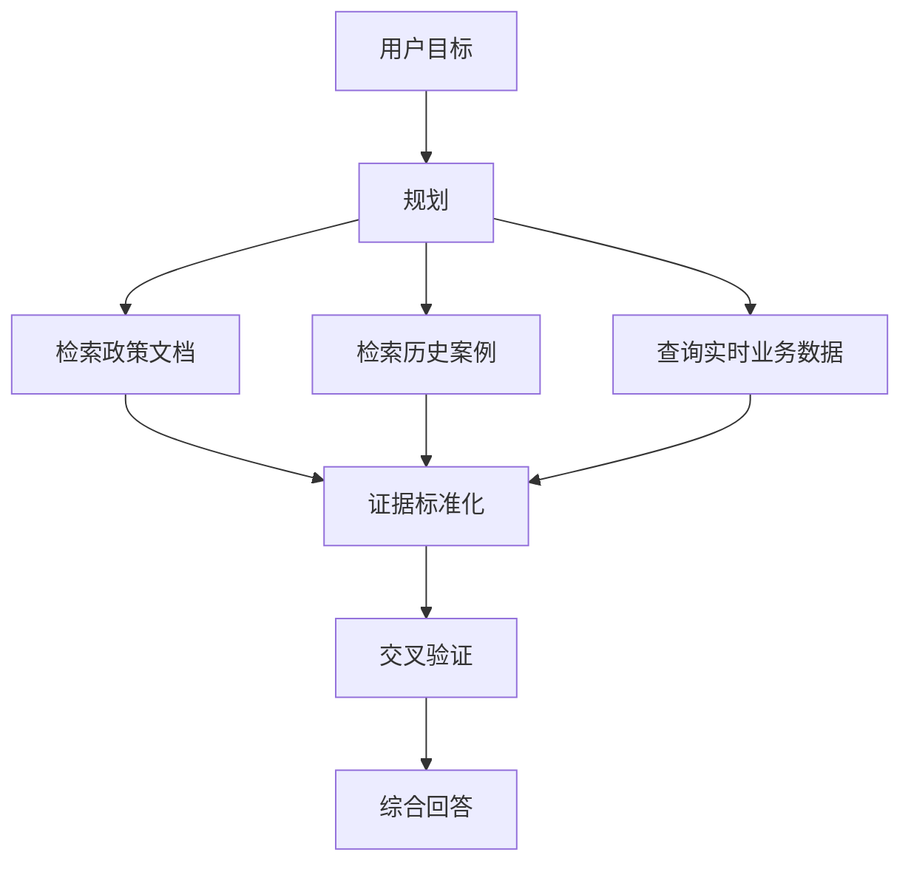

# V1.3-02 Planning、Task Decomposition 与 Multi-Agent 设计

> 公共字段、状态、事件、权限与迁移映射见 [统一契约与跨版本演进规则](../../architecture/统一契约与跨版本演进规则.md)；本文件描述本版能力及增量，具体实现须通过契约与升级验收。

## 1. 设计原则

Multi-Agent 是解决复杂任务的可选执行策略，不是默认架构。系统优先使用单 Agent + 多 Tool；只有任务确实存在可并行、可隔离的专业子任务时，才委派 Worker Agent。

## 2. 何时使用哪种模式

| 场景 | 推荐模式 | 原因 |
|---|---|---|
| 单知识库事实问答 | Standard RAG | 延迟和成本更低 |
| 多文档比较、跨主题综合 | Agentic RAG / 单 Agent | 需要迭代检索和综合 |
| 需要查询两个独立系统并综合 | Planner + 并行 Task | 任务可拆分 |
| 多专业领域并行分析 | Supervisor + Worker | 专业能力边界清晰 |
| 固定审批/报销/入职流程 | V1.4 Workflow Engine | 流程必须确定性执行 |
| 高风险业务写入 | Tool Policy + Human Approval | Agent 不能自行批准 |

## 3. Planner 分层

建议分为三层：
1. Intent / Complexity Router：识别简单问答、复杂分析、实时数据、业务动作。
2. Task Planner：把复杂目标转成任务 DAG。
3. Execution Supervisor：观察执行结果，判断继续、重试、重规划、请求用户补充或结束。

不要让一个超长 Prompt 同时承担意图识别、计划生成、执行决策和最终回答。

## 4. 任务拆解要求

有效任务必须具备：
- 明确目标与边界
- 输入来源和必要上下文
- 依赖关系
- 允许的能力
- 输出 Schema
- 完成标准
- 风险等级
- 截止时间和预算

避免过度拆解：若两个任务共享大量上下文、无法独立验证或拆解成本高于并行收益，应合并。

DAG 示例：



## 5. Supervisor-Worker 模式

Supervisor 负责：
- 接收目标和约束
- 选择允许的 Worker
- 分配有界子任务
- 汇总结果并检查冲突
- 决定是否补充任务或结束

Worker 负责：
- 在自身 Agent Definition 范围内完成子任务
- 只使用绑定的 Tools / Knowledge Base
- 返回结构化结果、证据引用、置信度和限制
- 不得自行继续创建任意子 Agent

建议 V1.3 仅实现两层：Supervisor → Worker。默认禁止 Worker 再委派 Worker。确有需求时通过显式配置和严格深度预算开放。

## 6. Agent Contract

委派输入：

```json
{
  "parent_run_id": "run_x",
  "task_id": "task_y",
  "objective": "分析某领域政策要求",
  "context_refs": ["artifact://..."],
  "allowed_capabilities": ["kb:policy:read"],
  "output_schema": {
    "summary": "string",
    "claims": [],
    "evidence": [],
    "limitations": []
  },
  "deadline": "ISO-8601",
  "budget": {
    "max_steps": 8,
    "max_tokens": 12000
  }
}
```

委派输出必须包含：
- `status`
- `summary`
- `structured_result`
- `evidence_refs`
- `confidence`
- `limitations`
- `usage`
- `child_run_id`

Worker 返回自由文本不应直接作为可信事实；Supervisor 必须做 Schema 验证、证据核验和冲突检测。

## 7. 并行执行与资源管理

- 并行仅用于无依赖任务。
- 并发上限由系统、用户、Agent Version 多级配额共同决定。
- 对同一外部系统的请求使用 Connector 级限流和并发保护。
- 任务完成后及时释放资源；超时 Worker 进入终止/隔离状态。
- 共享上下文使用 Artifact Reference，不复制整段对话到所有 Worker。
- 对重复子任务进行去重或缓存，但缓存键必须包含身份、权限范围、Agent Version 和输入摘要。

## 8. 结果聚合与冲突处理

Supervisor 聚合步骤：
1. 验证 Worker 输出 Schema。
2. 验证证据是否可访问、是否支持对应 Claim。
3. 识别相互矛盾的结论。
4. 对关键冲突触发追加检索或独立验证。
5. 无法解决时明确表达分歧，不得强行平均或虚构统一结论。
6. 输出结论、证据、限制和未完成事项。

## 9. 失败隔离

- 单 Worker 失败不必导致整个 Run 失败；由 Plan 定义是否允许降级。
- 不允许 Worker 无限重试或自行扩展任务。
- 父 Run 取消时向子 Run 传播取消。
- 子 Run 不能直接修改父 Run 状态。
- Worker 的 Tool 权限是显式委派的能力集合，不是父 Agent 全量权限继承。

## 10. 防止 Multi-Agent 失控

硬性限制：
- 最大委派深度默认 1。
- 最大 Worker 数、总 Step 数、总 Token、总成本均有限额。
- 禁止 Agent 之间无目标的对话循环。
- 禁止“为了更确定”而无上限反思。
- Planner 生成的每个任务都必须有完成标准。
- 达到停止条件即结束，不能由模型无限延长。

## 11. 验收标准

- 能将复杂任务拆成有依赖关系的 DAG。
- 并行任务只在依赖满足时执行。
- Worker 输入、输出和权限边界可审计。
- Worker 冲突可被检测并触发验证。
- Worker 失败可按策略降级。
- 深度、并发、成本和 Token 上限生效。
- 单 Agent 模式不受 Multi-Agent 功能影响。

## 12. 实现准入与裁剪

M0 固定真实协作场景、单 Agent 失败样本与质量/成本/延迟比较标准；M3 前确认收益来自专业协作，而不是缺检索、工具或预算配置。收益未证实时由产品/架构通过范围 ADR 决定是否延后并同步版本验收；本文件描述准入后的实现，不以设计文档数量作为投入依据。
