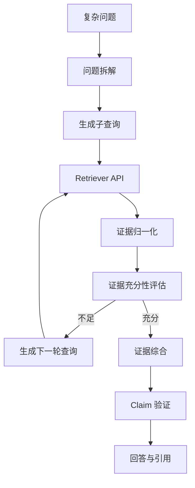

# V1.3-03 Agentic RAG 与证据工程设计

> 公共字段、状态、事件、权限与迁移映射见 [统一契约与跨版本演进规则](../../architecture/统一契约与跨版本演进规则.md)；本文件描述本版能力及增量，具体实现须通过契约与升级验收。

## 1. 目标

在 V1.0 Standard RAG 的基础上，支持复杂问题的迭代检索、Query Decomposition、Multi-hop Retrieval、证据去重、冲突识别和回答验证。Agent Runtime 调用统一 Retriever API，不直接访问 Elasticsearch。

## 2. Standard RAG 与 Agentic RAG 边界

| 维度 | Standard RAG | Agentic RAG |
|---|---|---|
| 适用 | 简单事实、单主题问答 | 多跳、跨文档、复杂分析 |
| 查询 | 单次或有限改写 | 规划多个子查询并迭代 |
| 检索 | 固定检索流水线 | 根据中间证据决定下一步 |
| 控制 | RAG Engine | Agent Runtime + RAG Engine |
| 成本 | 相对低 | 较高，需预算约束 |
| 默认 | 是 | 否 |

Router 应优先使用 Standard RAG。只有检测到多实体、多约束、跨文档关系或证据缺口时，才升级为 Agentic RAG。

## 3. Agentic Retrieval Loop



必须设置最大检索轮数、最大子查询数、总 Token 和时间预算。每一轮检索都记录 query、filters、retriever config、召回结果引用和耗时。

## 4. Query Decomposition

拆解目标：
- 将复合问题转成可独立检索的子问题。
- 明确实体、时间、范围、关系和约束。
- 识别问题间依赖，例如先确认政策版本，再查询条款。
- 子查询必须保留原始用户目标，不得改变问题含义。

每个子查询结构：
```json
{
  "query_id": "q1",
  "question": "string",
  "purpose": "string",
  "depends_on": [],
  "required_metadata": {},
  "expected_evidence": "string"
}
```

## 5. Retriever API Contract

Agentic RAG 只调用平台统一接口，例如：
- `search(query, knowledge_base_ids, filters, top_k, retrieval_profile)`
- `get_parent_context(chunk_ids, max_tokens)`
- `resolve_citations(evidence_ids)`
- `verify_access(evidence_ids, principal)`

输入必须包含可信 Principal Context。调用方不能自行伪造 ACL Filter；服务端从身份与策略上下文生成强制过滤条件。检索结果需返回 `document_id`、`chunk_id`、`version_id`、位置、内容摘要、权限判定结果和稳定 Evidence ID。

## 6. Evidence Model

Evidence 不是简单文本片段，而是可追溯对象：
- `evidence_id`
- `knowledge_base_id`
- `document_id`
- `document_version_id`
- `chunk_id`
- `chunk_version_id`
- `source_location`（页码、段落、表格单元格等）
- `content`
- `content_hash`
- `retrieval_query_id`
- `retrieval_round`
- `score` / `rank`
- `acl_decision_ref`
- `created_at`

证据内容在回答生成前必须再次验证可访问性，避免文档权限在检索后发生变化造成泄漏。

## 7. 多跳检索策略

支持：
- Entity Linking：识别同名实体和别名。
- Relation Expansion：围绕实体关系生成下一跳查询。
- Temporal Retrieval：明确时间范围和版本有效期。
- Parent Context Expansion：按 Token Budget 扩展父级上下文。
- Cross-document Join：在应用层按实体、时间、关系做证据关联，不把向量相似度当作关系事实。

V1.3 不要求建设独立知识图谱；先使用 Metadata、实体抽取结果和证据关联实现有限多跳检索。

## 8. 证据质量与冲突检测

质量维度：
- 相关性：是否回答子问题。
- 权威性：来源类型、发布主体和文档等级。
- 时效性：有效期、版本、更新时间。
- 完整性：是否缺少关键条件。
- 一致性：不同证据是否矛盾。
- 可追溯性：是否能定位原文。

冲突处理：
- 先检查版本、适用范围和时间差异。
- 不同适用范围的规则不能直接视为冲突。
- 仍冲突时追加检索或标记“证据不一致”。
- 不允许模型自行选择更符合预期的证据。

## 9. Claim-level Verification

最终回答先拆分关键 Claim，每个 Claim 必须关联支持证据：
- `claim_id`
- `claim_text`
- `evidence_ids`
- `support_level`: supported / partially_supported / unsupported / contradicted
- `verification_method`

规则：
- 关键结论 unsupported 时不得以确定语气输出。
- 证据仅部分支持时必须收窄表述。
- 无证据时拒答或请求补充资料。
- 引用必须指向真实 Document Version 和原文位置。
- 不能仅因检索分数高就认定 Claim 正确。

## 10. 与 Prompt Injection 的关系

检索到的文档可能包含恶意指令。系统必须将 Evidence 作为数据，不得将其中的指令当作系统指令执行。Agent Prompt 明确区分 System Policy、用户请求、检索证据和工具输出。检测到疑似注入时可标记、隔离或降低信任，但不得把检测器作为唯一安全屏障。

## 11. 性能和成本

- 先用低成本 Router 判断是否需要 Agentic RAG。
- 子查询并行执行，但受检索服务并发限额约束。
- 相同 Query + 身份权限 + KB Version 可安全缓存。
- 每轮记录召回量、去重量、有效证据量和成本。
- 设置检索轮数上限和早停条件。
- Reranker、Query Rewrite、Verification 模型均走 Model Gateway。

## 12. 验收标准

- 复杂问题能拆解并执行多轮检索。
- 简单问题仍走 Standard RAG。
- ACL 在每一轮检索中强制生效。
- Evidence 可追溯到文档版本和原文位置。
- Claim 与 Evidence 映射可查看。
- 冲突证据不会被静默合并。
- 预算和最大检索轮数有效。
