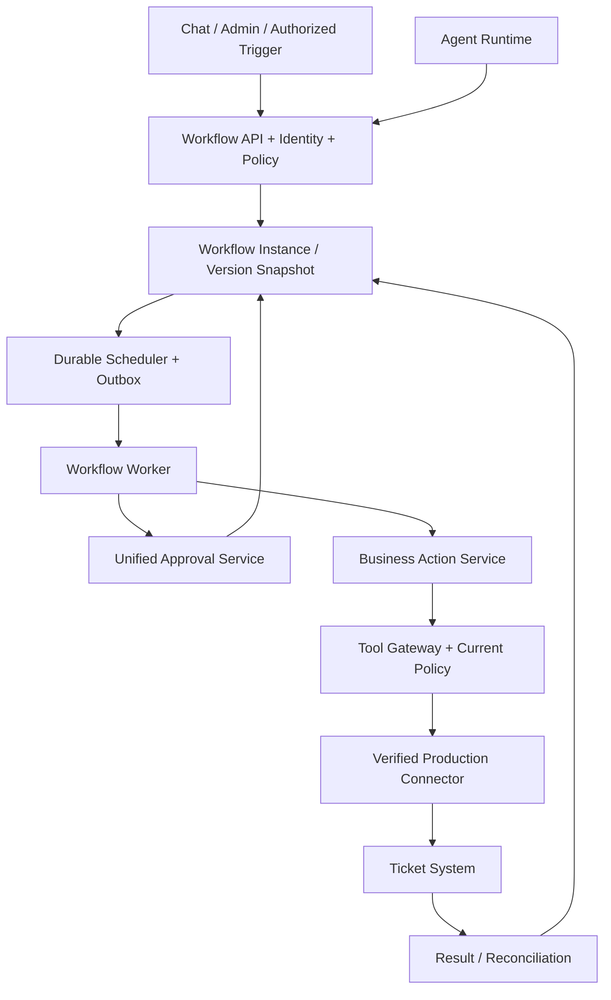
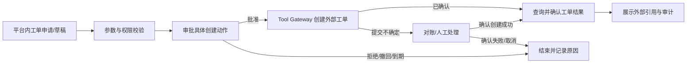

# 01｜Workflow Engine 与确定性执行架构

> 版本：V1.4，设计草案。公共字段、状态和执行域见 [统一契约第 10 节](../../architecture/统一契约与跨版本演进规则.md)；数据/API 增量见 [06](06-database-api-and-contract-design.md)。

## 1. 责任边界

Workflow Engine 负责批准规则的执行、条件分支、等待、定时器、取消和补偿。Agent 负责理解请求、检索、建议和生成草稿；它可以申请启动已发布流程，不能改写企业审批规则、指定批准结果或绕过 Tool Gateway。

Workflow 是平台独立领域，使用确定性解释器；LangGraph 继续只承载 Agent 内部执行。Worker 每次处理有界任务，等待状态落库后释放执行资源，跨天恢复依据数据库事实。



模块共享既有 Identity/Policy、Audit、Trace、对象存储和 Evaluation；逻辑分层不要求新增独立微服务。

## 2. 定义、版本与发布

Workflow Definition 保存稳定 workflow_key、名称、Owner 与当前发布指针；Workflow Version 保存不可变 definition_json、schema_version、Hash、Tool/Connector Binding 和审批策略快照。

新草稿经 Schema、引用授权、图可达性、必需分支、超时/重试/补偿、审批及回归 Gate 验证后发布。发布/回滚原子切换指针，运行中实例继续固定旧版本；当前身份、Policy 和凭据可用性在执行前重新判断。

V1.4 最小解释器支持 DAG、受控条件分支和有界步骤重试。跨天流程通过 wait_event/timer 表达；任意循环、脚本、表达式 eval 和用户定义 Python 不是本版必需能力。

| 步骤类型 | 职责 | 执行结果来源 |
|---|---|---|
| validate | Schema/业务字段与资源范围验证 | 受控规则 |
| condition | 比较已验证输入/结果并选择边 | 白名单操作符和字段引用 |
| approval | 创建/等待审批请求 | 统一审批决定服务 |
| tool | 读取或写入业务系统 | Tool Gateway |
| wait_event | 等待已授权关联事件 | 持久事件和关联规则 |
| timer | 到指定业务时间后唤醒 | 持久定时器 |
| confirm | 查询外部事实/对账 | 已验收的只读 Tool |
| notify | 受控通知 | Tool Gateway，同样评估副作用与审批策略 |
| end | 结束本次自动推进并汇总结果；是否终态依 status/事实条件判断 | 引用已确认结果，NEEDS_REVIEW 仍等待受控处理 |

Condition 仅允许 eq/ne/in/gt/gte/lt/lte/exists 等受控操作；字段类型、缺值和分支默认行为经 Schema 校验。用户字符串作为数据处理，表达式求值不解释模板代码。

## 3. 工单参考流程



示例中的工单系统和工具名称待接口冻结：`ticket.create`、`ticket.lookup_by_operation_key`、`ticket.get`；`ticket.cancel` 仅在目标系统支持、当前状态允许且获得授权时作为补偿。

```json
{
  "schema_version": "1.0",
  "workflow_key": "ticket.create_with_approval",
  "input_schema_ref": "ticket_application_v1",
  "deadline_policy_ref": "ticket_deadlines_v1",
  "retry_policy_ref": "ticket_retries_v1",
  "on_timeout": "end_timed_out",
  "steps": [
    {"step_key": "validate_request", "type": "validate", "next": "approve_create", "failed_next": "end_failed"},
    {"step_key": "approve_create", "type": "approval", "action_step_key": "create_ticket", "approval_policy_ref": "ticket_creation_policy_v1", "on_approved": "create_ticket", "on_rejected": "end_rejected", "on_cancelled": "end_cancelled", "on_expired": "end_expired"},
    {"step_key": "create_ticket", "type": "tool", "tool_binding_ref": "ticket_create_v1", "result_next": "confirm_ticket", "unknown_next": "reconcile_create", "failed_next": "end_failed", "compensation_binding_ref": "ticket_cancel_v1"},
    {"step_key": "reconcile_create", "type": "confirm", "tool_binding_ref": "ticket_lookup_by_operation_key_v1", "confirmed_next": "confirm_ticket", "failed_next": "end_failed", "unresolved": "needs_review"},
    {"step_key": "confirm_ticket", "type": "confirm", "tool_binding_ref": "ticket_get_v1", "next": "end_succeeded", "retry_exhausted_next": "end_needs_review"},
    {"step_key": "needs_review", "type": "wait_event", "event_kind": "action.reconciliation.resolved", "on_confirmed": "confirm_ticket", "on_failed": "end_failed", "on_cancelled": "end_cancelled"},
    {"step_key": "end_needs_review", "type": "end", "status": "NEEDS_REVIEW", "result_code": "CONFIRMATION_UNRESOLVED"},
    {"step_key": "end_rejected", "type": "end", "status": "FAILED", "result_code": "APPROVAL_REJECTED"},
    {"step_key": "end_expired", "type": "end", "status": "FAILED", "result_code": "APPROVAL_EXPIRED"},
    {"step_key": "end_failed", "type": "end", "status": "FAILED", "result_code": "OPERATION_FAILED"},
    {"step_key": "end_cancelled", "type": "end", "status": "CANCELLED", "result_code": "REQUEST_CANCELLED"},
    {"step_key": "end_timed_out", "type": "end", "status": "TIMED_OUT", "result_code": "WORKFLOW_DEADLINE_EXCEEDED"},
    {"step_key": "end_succeeded", "type": "end", "status": "SUCCEEDED", "result_code": "TICKET_CONFIRMED"}
  ]
}
```

这是设计结构示例；正式 JSON Schema、Deadline/重试策略和 Binding 由 M0 冻结。end 的 NEEDS_REVIEW 是停止自动派发的等待结果，不是完成终态；确认失败与未知提交保持 Action 事实，由受控对账/恢复命令继续，不能重走 create。全局 on_timeout 只在外部效果已闭合时进入终态，否则转 NEEDS_REVIEW。实际不支持取消的系统必须移除补偿 Binding，改为已批准的人工补救路径，不能把示例当成厂商接口事实。

审批前解析并持久化实际 Tool Version、Connector Instance、目标资源和最终写入参数，生成 parameter_hash。审批通过后引用该解析快照执行；重新解析得到不同参数或 Binding 时重回审批，不在模型中补齐未经批准的数据。

## 4. 实例与步骤运行

创建实例先验证主体和 Workflow Version，持久化输入摘要/引用、请求 Hash、幂等键与初始事件；重复相同请求返回同一 instance_id。published 选择意图重试复用首次解析的版本。

流程实例的公共状态依统一契约枚举。运行、等待审批、等待事件、暂停和 NEEDS_REVIEW 是非终态；失败、取消和超时只有在待执行动作停止且外部效果已知/明确记录后才可终结。步骤重试写独立 Attempt，不覆盖旧结果。

Scheduler 使用依赖、状态和 due_at 找到可运行步骤，以条件更新/租约和递增 fencing_token 防止并发推进。DB 更新步骤与 Outbox 同事务；网络调用在事务外执行，操作事实和请求 Key 在调用前可靠保存。

实例取消仅阻止新的动作派发；已提交操作必须确认状态，并按授权策略补偿。Worker 崩溃、超时与租约失效不能证明外部写入失败，UNKNOWN 路径见 [04](04-events-scheduling-compensation-and-recovery.md)。

## 5. Agent 与 Workflow 协作

`start_workflow` 是已注册受控平台能力，Agent 只提交申请数据与明确流程版本选择，主体由可信上下文注入。Workflow Service 独立计算 workflow.start 和资源授权，并固定输入/版本。

实例使用 origin_agent_run_id 记录来源；Agent Run 与 Workflow Instance 分别恢复、取消和保留，不互相改写状态。Workflow 结果通过受控查询/事件引用返回 Agent；来源 Agent 已结束不意味着跨天流程成功或可以跳过当前授权。

流程中确需调用 Agent 时，仅通过 Runtime Facade 创建已发布版本的独立 Run，保存引用与受控输出；输出再次按业务 Schema 验证，不能作为 ApprovalDecision。该增强可列 P1，不阻断工单 P0 闭环。

## 6. 验收

- 发布非法/环形/不可达图时被拒绝；实例绑定确定快照。
- 草稿提交不会写入外部系统；审批拒绝/撤回/到期阻止创建动作。
- 断电或 Worker 重启后从持久步骤恢复，长等待不占 Worker。
- 并发创建和重复消息不产生第二实例或重复外部工单。
- 权限/参数变化后的审批不会被复用；UNKNOWN 不按失败自动重放。
- 独立 Workflow 与旧 Agent Run/API 均保持可用，结果能定位到外部工单和业务审计。
